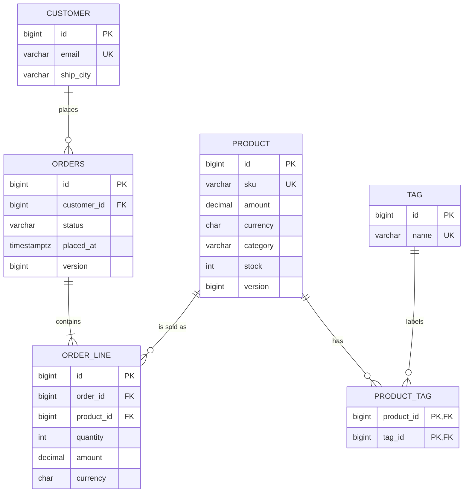

# shop-jpa — Lab 03: Hibernate Framework and Spring Data JPA

Spring Boot 4.1.1 · Hibernate ORM 7.4.5 · Flyway · H2 · Java 25.
Flyway owns the schema (`src/main/resources/db/migration`); Hibernate only **validates** it (`ddl-auto: validate`).

Run the app: `./mvnw spring-boot:run` — H2 console at <http://localhost:8080/h2-console>
(JDBC URL `jdbc:h2:mem:shop`, user `sa`, empty password).

## Task 1 — Entities and mappings, validated by Flyway

### Start-up with a correct schema

```text
o.f.core.internal.command.DbMigrate : Current version of schema "PUBLIC": << Empty Schema >>
o.f.core.internal.command.DbMigrate : Migrating schema "PUBLIC" to version "1 - init"
o.f.core.internal.command.DbMigrate : Successfully applied 1 migration to schema "PUBLIC", now at version v1
j.LocalContainerEntityManagerFactoryBean : Initialized JPA EntityManagerFactory for persistence unit 'default'
edu.itc.shop.ShopJpaApplication : Started ShopJpaApplication in 2.0 seconds
```

### Deliberate mismatch 1 — missing column

In `V1__init.sql` only, the `product` column `sku` was renamed to `code` (the entity was left unchanged).
Flyway still applied the migration (the SQL itself is valid), but Hibernate refused to start:

```text
Caused by: org.hibernate.tool.schema.spi.SchemaManagementException:
  Schema validation: missing column [sku] in table [product]
```

Reverted afterwards.

### Deliberate mismatch 2 — sequence increment

In `V1__init.sql` only, `product_seq` was declared `INCREMENT BY 1` while the entity says `allocationSize = 50`:

```text
Caused by: org.hibernate.MappingException:
  The increment size of the [product_seq] sequence is set to [50] in the entity mapping
  but the mapped database sequence increment size is [1]
```

Reverted afterwards. The `INCREMENT BY 50` in the migration must always equal `allocationSize` in the
`@SequenceGenerator`; otherwise Hibernate (pooled optimizer) would hand out colliding ids.

### A third mismatch found along the way — `CHAR(3)` vs `VARCHAR`

The first start-up with the spec's `currency CHAR(3)` failed validation:

```text
Schema validation: wrong column type encountered in column [currency] in table [order_line];
  found [character (Types#CHAR)], but expecting [varchar(3) (Types#VARCHAR)]
```

A Java `String` maps to `VARCHAR` by default. Fixed on the mapping side with
`@JdbcTypeCode(SqlTypes.CHAR)` on `Money.currency`, so the SQL keeps `CHAR(3)`.

### Notes on the model

* `Money` and `Address` are `@Embeddable` records; `Customer.shipping` reuses `Address` with
  `@AttributeOverride` to the `ship_*` columns.
* `Category` and `OrderStatus` use `@Enumerated(EnumType.STRING)`, stored as text, never as ordinals.
* All ids are `Long` with `GenerationType.SEQUENCE`, a named `@SequenceGenerator` and `allocationSize = 50`;
  there is no `setId` anywhere. Entities have `protected` no-arg constructors.
* `ProductMappingTest` (`@DataJpaTest` + `Replace.NONE`) runs Flyway and validation against H2, persists a
  `Product`, flushes and clears, reloads it, and checks via a native query that `category` contains `HARDWARE`.

## Task 2 — associations, cascading, and entity identity

`Order.lines` is the inverse side (`mappedBy = "order"`) with `cascade = ALL` and `orphanRemoval`;
`OrderLine.order` owns the foreign key. `addLine` initializes both sides and snapshots the product
price into the line. `removeLine` removes from the aggregate and clears the owning reference.
`Product.tags` owns the `product_tag` join table and `Tag.products` is inverse; `Product.tag`
maintains both in-memory collections. All entities use hand-written persistent-id equality with a
stable per-class hash code. Their `toString()` methods print scalar values only.

Run the Task 2 acceptance tests with:

```sh
./mvnw -q test -Dtest=OrderCascadeTest,EntityIdentityTest
```

`OrderCascadeTest` checks the emitted entity counts after persisting an order with two lines:
three inserts (one order plus two lines), zero updates, and a total of `45.00`. After clearing and
reloading, it verifies orphan removal deletes one line, then removing the order cascades the final
line deletion. SQL captured from Hibernate on H2:

```sql
insert into orders (customer_id, placed_at, status, version, id) values (?, ?, ?, ?, ?);
insert into order_line (order_id, product_id, quantity, amount, currency, id) values (?, ?, ?, ?, ?, ?);
insert into order_line (order_id, product_id, quantity, amount, currency, id) values (?, ?, ?, ?, ?, ?);
delete from order_line where id = ?;            -- orphan removal
delete from order_line where id = ?;            -- cascade REMOVE
delete from orders where id = ? and version = ?;
```

`EntityIdentityTest` verifies a `HashSet<Product>` still contains the product after persistence,
then reloads Customer, Product, Tag, Order, and OrderLine in a cleared persistence context and checks
each pair is equal but not the same Java object.

The `toString` association pitfall was reproduced temporarily by including `Order.lines` and
`OrderLine.order` in their string output, then printing a detached order outside the transaction.
The result was `org.hibernate.LazyInitializationException` while traversing the lazy lines
collection. Those association references were reverted; current `toString()` implementations do
not traverse relationships (and so avoid both lazy-loading failures and bidirectional recursion).

## Challenge — reporting, feeds, reservations, and bulk import

### Six-table schema



`V2__product_version.sql` adds the product optimistic-lock version and the feed/report indexes:
`orders(placed_at DESC, id DESC)`, `product(category, amount)`, and `product_tag(tag_id, product_id)`.

### Criteria API report

`GET /api/reports/products` supports any combination of `q`, `category`, `maxPrice`, `minStock`,
`tag`, and `sort`. The custom fragment builds Criteria predicates and the
`ProductReportRow(sku, name, amount, stock, tagCount)` constructor projection with `cb.construct`.
Product and embedded-money fields use the generated static metamodel. A root `tags` join is added
only for a non-empty `tag` filter; a correlated count subquery calculates `tagCount`, and selected
product columns are grouped. Allowed sort keys are `sku`, `name`, `amount`, `stock`, and `tagCount`;
direction is `asc` or `desc` (default `sku,asc`). Unknown sort keys return HTTP 400.

```sh
curl -s 'localhost:8080/api/reports/products?category=HARDWARE&minStock=1&tag=sale&sort=amount,desc'
```

Hibernate SQL captured from the tagged report test (the no-tag-filter case omits the root tag joins):

```sql
select p.sku, p.name, p.amount, p.stock,
       (select count(distinct pt.tag_id)
          from product p2 left join product_tag pt on p2.id = pt.product_id
         where p.id = p2.id)
  from product p
  join product_tag pt_filter on p.id = pt_filter.product_id
  join tag t on t.id = pt_filter.tag_id
 where (lower(p.sku) like ? or lower(p.name) like ?)
   and p.category = ? and p.amount <= ? and p.stock >= ? and lower(t.name) = ?
 group by p.sku, p.name, p.amount, p.stock
 order by p.amount desc
```

### Infinite order feed

`GET /api/orders/feed?size=20&after=<placedAt>,<id>` returns
`{ "items": [...], "nextCursor": "...", "hasNext": true }`. The default `strategy=keyset` uses Spring
Data `Window<Order>` and `ScrollPosition.keyset()`; `strategy=slice` selects the `Slice<Order>` version.
Both use descending `(placedAt,id)` ordering, a stable tie-breaker, and the same opaque timestamp/id
cursor. Sizes are bounded to 1–100. The observed Hibernate SQL shapes are:

```sql
-- Slice<OrderSummary>, first window
select o.id, o.status, o.placed_at, c.* from orders o join customer c on c.id = o.customer_id
 where o.id is not null
 order by o.placed_at desc, o.id desc
 fetch first ? rows only

-- Slice<OrderSummary>, after cursor; Slice reads one extra row to determine hasNext
select o.id, o.status, o.placed_at, c.* from orders o join customer c on c.id = o.customer_id
 where o.placed_at < ? or (o.placed_at = ? and o.id < ?)
 order by o.placed_at desc, o.id desc
 fetch first ? rows only

-- Keyset, initial Window
select o.* from orders o
 order by o.placed_at desc, o.id desc
 fetch first ? rows only

-- Keyset, next Window; Spring Data uses the last row's keyset values
select o.* from orders o
 where o.placed_at < ? or (o.placed_at = ? and o.id < ?)
 order by o.placed_at desc, o.id desc
 fetch first ? rows only
```

The Slice API itself is an offset-based `Pageable` abstraction. This endpoint always starts its
Slice at page zero and advances with a cursor predicate rather than a page number; the `Window`
variant is genuinely keyset-scrolled. Neither next-window query has `OFFSET`. The `(placed_at,id)`
index seeks to the cursor and reads the next `size + 1` entries, so work does not grow with an
offset such as 100,000 (which must walk/skip the preceding rows).

### Stock reservations

`StockService.reserve(productId, qty)` takes a `PESSIMISTIC_WRITE` lock through
`ProductRepository.findForUpdate`, checks availability, and decrements inside one service
transaction. The alternative `reserveOptimistically` uses the `@Version` column and retries the
whole transaction with a fresh entity on a version conflict. `reserveAtomically` executes a
conditional `UPDATE` and increments the version in the same statement so it cannot overwrite an
optimistic writer's state.

The 10-thread test starts all reservations together for stock 5 and verifies exactly five successes,
five `OutOfStockException`s, and final stock 0 for each strategy. One local H2 run (Java 25,
Hibernate 7.4.5) measured:

| Strategy | Result | Elapsed for 10 concurrent requests |
|---|---:|---:|
| Pessimistic row lock | 5 success / 5 out-of-stock | 35 ms |
| Optimistic `@Version` with retry | 5 success / 5 out-of-stock | 13 ms |
| Conditional atomic update | 5 success / 5 out-of-stock | 37 ms |

These are a single local run, not portable performance guarantees (the optimistic run observed
two retries among successful callers). SQL logged for the critical paths is
`select ... from product where id = ? for update`, a version-checked entity update, and:

```sql
update product
   set stock = stock - ?, version = version + 1
 where id = ? and stock >= ?
```

### 50,000-product import

`BulkImportService.importCsv(Path)` streams semicolon-delimited rows into a Hibernate 7
`StatelessSession`, sets JDBC batch size to 500, and calls `insertMultiple` for each full chunk.
The comparison methods use `saveAll` in one transaction, either retaining the persistence context
for all rows or flushing and clearing every 500. `BulkImportTest` creates separate 50,000-row CSVs,
samples peak heap growth during each import, checks all rows were imported, and enforces the
10-second target for the stateless path.

Measured locally on H2 2.4.240, Java 25.0.4.1, Hibernate 7.4.5.Final:

| Strategy | Rows | Wall time | Peak heap growth |
|---|---:|---:|---:|
| `StatelessSession.insertMultiple(500)` | 50,000 | 1.669 s | +177 MB |
| `saveAll`, one transaction, no clear | 50,000 | 2.378 s | +306 MB |
| `saveAll` + `flush()/clear()` every 500 | 50,000 | 1.052 s | +169 MB |

Heap figures are sampled increases after a GC before each run; timings and heap use vary by runtime
and machine. The stateless import used 100 full batches.

### Repository methods and observed Hibernate SQL

The following table covers every application-declared repository query method (including the custom
report fragment and both feed variants), plus inherited CRUD operations used by services/tests.
SQL below is the corresponding Hibernate SQL-log shape, with bind values represented by `?`.

| Repository method | SQL Hibernate generates |
|---|---|
| `CustomerRepository.findByEmail` | `select c.* from customer c where c.email = ?` |
| `CustomerRepository.existsByEmail` | `select count(*) from customer c where c.email = ?` |
| `TagRepository.countByName` | `select count(t.id) from tag t where t.name = ?` |
| `ProductRepository.existsBySku` | `select p.id from product p where p.sku = ? fetch first ? rows only` |
| `ProductRepository.findTop3ByCategoryOrderByPriceAmountDesc` | `select p.* from product p where p.category = ? order by p.amount desc fetch first ? rows only` |
| `ProductRepository.findByCategory` | `select p.id, p.sku, p.name, p.amount, p.stock from product p where p.category = ? order by ... offset ? rows fetch first ? rows only`; count: `select count(p.id) from product p where p.category = ?` |
| `ProductRepository.findLowStock` (native) | `SELECT p.* FROM product p WHERE p.stock < ? ORDER BY p.stock` |
| `ProductRepository.findForUpdate` | `select p.* from product p where p.id = ? for update` |
| `ProductRepository.decrementStockIfAvailable` | `update product set stock = stock - ?, version = version + 1 where id = ? and stock >= ?` |
| `ProductReportRepository.findProductReport` | Dynamic `select` with the conditional tag join, tag-count subquery, optional predicates, `group by p.sku, p.name, p.amount, p.stock`, and whitelisted `order by`; representative query is shown above. |
| `ProductRepository.findAll(Specification, Pageable)` | Dynamic `select p.* from product p where ... order by ... offset ? rows fetch first ? rows only`; Spring Data also issues `select count(p.id) from product p where ...` when total pages are needed. |
| `OrderRepository.findByCustomerEmailAndStatusOrderByPlacedAtDesc` | `select o.* from orders o join customer c on c.id = o.customer_id where c.email = ? and o.status = ? order by o.placed_at desc` |
| `OrderRepository.countByStatus` | `select count(o.id) from orders o where o.status = ?` |
| `OrderRepository.findFirstByCustomerIdOrderByPlacedAtDesc` | `select o.* from orders o where o.customer_id = ? order by o.placed_at desc fetch first ? rows only` |
| `OrderRepository.findByStatus` | `select o.id, o.status, o.placed_at, c.* from orders o join customer c on c.id = o.customer_id where o.status = ? order by ... offset ? rows fetch first ? rows only`; count query: `select count(o.id) from orders o where o.status = ?` |
| `OrderRepository.findWithLinesByCustomerEmail` | `select distinct o.*, l.*, p.* from orders o join order_line l on o.id = l.order_id join product p on p.id = l.product_id join customer c on c.id = o.customer_id where c.email = ? order by o.placed_at desc` |
| `OrderRepository.countLinesByStatus` | `select count(l.id) from order_line l join orders o on o.id = l.order_id where o.status = ?` |
| `OrderRepository.findByIdIsNotNullOrderByPlacedAtDescIdDesc` (Slice first window) | `select o.* from orders o where o.id is not null order by o.placed_at desc, o.id desc fetch first ? rows only` |
| `OrderRepository.findFeedAfter` (Slice cursor window) | `select o.* from orders o where o.placed_at < ? or (o.placed_at = ? and o.id < ?) order by o.placed_at desc, o.id desc fetch first ? rows only` |
| `OrderRepository.findAllByOrderByPlacedAtDescIdDesc` (keyset Window) | First window: `select o.* from orders o order by o.placed_at desc, o.id desc fetch first ? rows only`; next window adds `where o.placed_at < ? or (o.placed_at = ? and o.id < ?)` |
| Inherited `findById`, `existsById`, `count`, `save` | `select ... from <table> where id = ?`; `select count(*) ... where id = ?`; `select count(*) from <table>`; `insert into <table> (...) values (...)` for new entities, or version-aware `update ... where id = ? and version = ?` for updates. |

The SQL examples are from the repository tests with Hibernate SQL logging enabled; paging limits and
select aliases can vary by Hibernate dialect/version.
