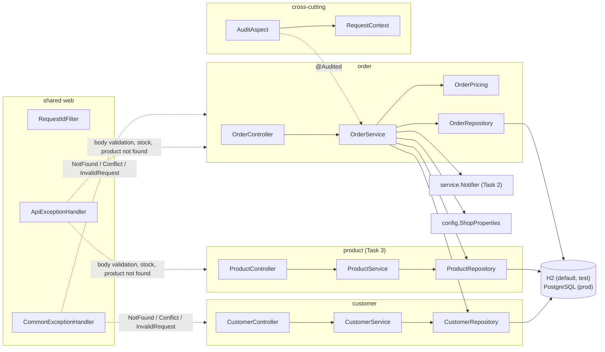
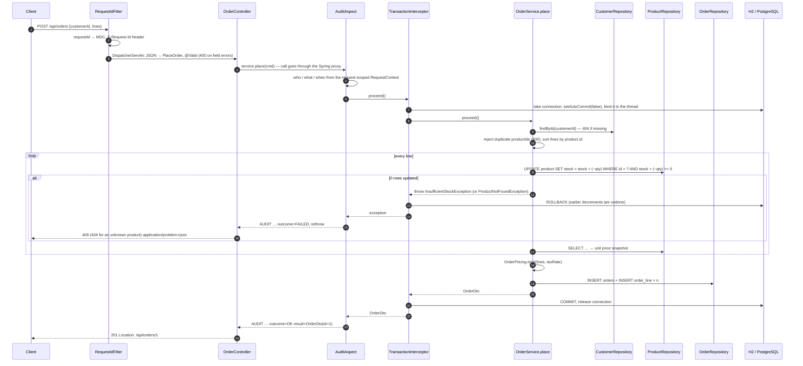

## Task 2 - Which @Primary wins?

Spring resolves an injection point of type `Notifier` like this:
1. Find all beans of that type.
2. If the injection point has `@Qualifier("name")`, pick the bean with that name.
3. Otherwise, if exactly one candidate is `@Primary`, pick it.
4. Otherwise, try to match the parameter name to a bean name; if that fails, error.

Without a profile, `ConsoleNotifier` does not exist (`@Profile("dev")`), so the only
`@Primary` bean is `EmailNotifier` and it is used.

With `--spring.profiles.active=dev`, both `EmailNotifier` and `ConsoleNotifier` are
`@Primary`. Spring has no rule that ranks one primary above another, so start-up fails
with `NoUniqueBeanDefinitionException` ("more than one 'primary' bean found among candidates").

Fix applied: `@Profile("!dev")` on `EmailNotifier`, so each profile has exactly one
`@Primary` notifier - default uses `EmailNotifier`, dev uses `ConsoleNotifier`.


hello


---

## Challenge — layered order management

Extra-credit challenge of **Lab-02: Spring Framework**. The `shop` application from Tasks 1–5 gets **customers and
orders**:

- A customer places an order with several lines.
- Stock is reserved for **all lines or for none**.
- Orders can be listed page by page and filtered.
- A NEW order can be cancelled, which gives the stock back and notifies the customer.

The new code is **packaged by feature** (`order/`, `customer/`) and tested at **four levels** (unit, `@JdbcTest`,
`@WebMvcTest`, end-to-end). The product code from Tasks 3–5 was left where it is (`web/`, `service/`, `repository/`,
`domain/`) and is reused, not rewritten.

### Contents

1. [What the challenge asks for, and where it is](#1-what-the-challenge-asks-for-and-where-it-is)
2. [Technologies and Spring features used](#2-technologies-and-spring-features-used)
3. [Project structure (package by feature)](#3-project-structure-package-by-feature)
4. [Database](#4-database)
5. [REST API](#5-rest-api)
6. [Request flow of "place order"](#6-request-flow-of-place-order)
7. [Transaction boundary — where and why](#7-transaction-boundary--where-and-why)
8. [Audit: `@Audited` + request-scoped bean](#8-audit-audited--request-scoped-bean)
9. [Profiles: default, test, prod (PostgreSQL)](#9-profiles-default-test-prod-postgresql)
10. [How to run](#10-how-to-run)
11. [How to run the tests](#11-how-to-run-the-tests)
12. [Notes and known limitations](#12-notes-and-known-limitations)

---

### 1. What the challenge asks for, and where it is

| Requirement | Implementation |
|---|---|
| Tables `customer`, `orders`, `order_line`; status `NEW`, `PAID`, `CANCELLED` | `src/main/resources/schema.sql` (H2), `db/postgresql/schema.sql` (PostgreSQL), `order/OrderStatus` |
| Repositories with `JdbcClient`, package by feature | `order/OrderRepository`, `customer/CustomerRepository`, `repository/ProductRepository` (Task 3) |
| `POST /api/orders`: validate, decrement stock in **one** `@Transactional` method, snapshot price, total with tax, 201 | `order/PlaceOrder` (validation), `order/OrderService.place`, `order/OrderPricing`, `order/OrderController` |
| Not enough stock on any line → 409 and **nothing changed** | guarded `UPDATE` + rollback; proven by `OrderFlowE2ETest` |
| `GET /api/orders?customerId=&status=&page=&size=` with `LIMIT/OFFSET`, `GET /api/orders/{id}` | `OrderRepository.findPage` / `count`, `common/Page` |
| `POST /api/orders/{id}/cancel`: only NEW, returns stock, notifies; otherwise 409 | `OrderService.cancel` + `service/Notifier` from Task 2 |
| `@Audited` + aspect (who / what / when) with a request-scoped bean holding the request id | `audit/Audited`, `audit/AuditAspect`, `audit/RequestContext` |
| `test` profile with H2 and its own `data-test.sql` | `src/test/resources/application-test.yml`, `data-test.sql` |
| `prod` profile on PostgreSQL, `docker-compose.yml`, driver as runtime dependency | `application-prod.yml`, `docker-compose.yml`, `pom.xml` (`<scope>runtime</scope>`) |
| Tests: pricing unit test, `@JdbcTest`, `@WebMvcTest`, one `RANDOM_PORT` end-to-end test | see [section 11](#11-how-to-run-the-tests) |
| Report: package diagram, request flow, transaction boundary | sections 3, 6 and 7 below |

Files from Tasks 1–5 that the challenge had to touch (everything else is new):

| File | Change |
|---|---|
| `actuator/LOWStockHealthIndicator.java` | renamed to `LowStockHealthIndicator.java`; the build failed because the file name did not match the class name |
| `schema.sql`, `data.sql` | `customer`, `orders`, `order_line` tables and 3 customers appended; product rows unchanged |
| `application-prod.yml` | PostgreSQL driver class and the `db/postgresql/*.sql` scripts added |
| `pom.xml` | `org.postgresql:postgresql` with `runtime` scope added |
| `README.md` | this section appended |

---

### 2. Technologies and Spring features used

#### Stack

| | Version | Used for |
|---|---|---|
| Java | 25 | records, text blocks |
| Spring Boot | 4.1.1 | auto-configuration, embedded Tomcat, profiles, Actuator |
| Spring Framework | 7.0.9 | Web MVC, `JdbcClient`, transactions, AOP |
| Maven (wrapper `./mvnw`) | 3.10.0 | build and tests; no local Maven needed |
| H2 | 2.4.240 | in-memory database for the default profile and `test` |
| PostgreSQL + Docker Compose | 17 (`postgres:17-alpine`), driver 42.7.13 | database for `prod` |
| Hibernate Validator (Bean Validation) | 9.1.3 | `@NotNull`, `@NotEmpty`, `@Min`, `@Max` on requests |
| AspectJ (`spring-boot-starter-aspectj`) | 1.9.25 | `@Aspect` audit and timing advice |
| Jackson | 3.1.5 | JSON (records, `OffsetDateTime`) |
| JUnit Jupiter / Mockito / AssertJ | 6.0 / 5.23 / 3.27 | tests |
| MockMvc, `RestTestClient` | Spring Test 7 | controller slice tests, real-HTTP end-to-end test |

#### Spring concepts applied in the challenge

| Concept | Where |
|---|---|
| Layered architecture **controller → service → repository**, package by feature | `order/`, `customer/` (and the Task 3 product layers) |
| Constructor injection, `final` fields, no field injection | every new bean |
| `JdbcClient` with **named, bound parameters** (no SQL string building from input) | all repositories |
| Declarative transactions: `@Transactional`, `@Transactional(readOnly = true)` | `OrderService` |
| Atomic **guarded updates** (`… WHERE stock + :delta >= 0`, `… WHERE status = :from`) | `ProductRepository.updateStock`, `OrderRepository.updateStatus` |
| Bean Validation on request records, including nested lists (`@Valid List<@NotNull Line>`) | `order/PlaceOrder` |
| Method validation on request parameters (`@Min(0) page`, `@Min(1) @Max(100) size`) | `OrderController.list` |
| RFC 9457 **`ProblemDetail`** for every error | `web/ApiExceptionHandler` (Task 3) + `common/CommonExceptionHandler` |
| AOP: custom annotation + `@Around` advice, ordered outside the transaction | `audit/AuditAspect` |
| **Request scope** (`@RequestScope`) injected into a singleton through a scoped proxy | `audit/RequestContext` → `AuditAspect` |
| Servlet filter + MDC for a request id in every log line | `config/RequestIdFilter` (Task 5) |
| Type-safe, validated configuration (`@ConfigurationProperties` record) | `config/ShopProperties` (`taxRate`, `currency`) |
| A `Clock` bean, so time is injectable and testable | `config/AppConfig`, used by `OrderService` and `AuditAspect` |
| Profiles and SQL init (`spring.sql.init.*`) | `application.properties`, `application-test.yml`, `application-prod.yml` |
| Test slices and full tests: `@JdbcTest`, `@WebMvcTest` + `@MockitoBean`, `@SpringBootTest(RANDOM_PORT)` | `src/test/java` |

---

### 3. Project structure (package by feature)

The two new features each hold their own **web, service and repository** classes. Shared code lives in a few
small packages. The classes from Tasks 1–5 are reused as they are.

```
src/main/java/edu/itc/shop
├── order/          the challenge (new)
│   ├── OrderController          web      POST /api/orders, GET list / by id, POST /{id}/cancel
│   ├── OrderService             service  place(), cancel(), list(), findById()  — @Transactional, @Audited
│   ├── OrderRepository          repo     JdbcClient: insert, findById, findLines, findPage (LIMIT/OFFSET), count, updateStatus
│   ├── OrderPricing             pure     net and total with tax (no Spring)
│   ├── PlaceOrder, OrderDto     request / response records
│   ├── Order, OrderLine, OrderStatus
│   └── OrderNotFoundException, OrderNotCancellableException
├── customer/       (new) CustomerController → CustomerService → CustomerRepository, Customer, CustomerNotFoundException
├── audit/          (new) @Audited, AuditAspect, RequestContext (@RequestScope)
├── common/         (new) NotFoundException (→404), ConflictException (→409), InvalidRequestException (→400),
│                         Page<T>, CommonExceptionHandler
├── web/            Task 3–5: ProductController, ProductPageController, ApiExceptionHandler, dto/…
├── service/        Task 2–5: ProductService, Notifier + Email/Sms/ConsoleNotifier, WelcomeService, TimingAspect, …
├── repository/     Task 3:   ProductRepository
├── domain/         Task 3:   Product
├── actuator/       Task 5:   LowStockHealthIndicator
└── config/         AppConfig (Clock bean), ShopProperties, ShopConfig, RequestIdFilter
```



Dependencies go one way: controller → service → repository → database. `OrderService` uses `ProductRepository` (as
in the lab's skeleton) and `CustomerRepository`, and reuses `InsufficientStockException` and
`ProductNotFoundException` from Task 3. `CommonExceptionHandler` runs before `ApiExceptionHandler`
(`@Order(HIGHEST_PRECEDENCE)`) and only applies to the `order` and `customer` controllers. Whatever it does not
handle falls through to `ApiExceptionHandler`, so the product endpoints behave exactly as before.

---

### 4. Database

```
customer   (id PK, name, email UNIQUE)
product    (id PK, name UNIQUE, price DECIMAL(10,2), stock INT CHECK (stock >= 0))      ← Task 3
orders     (id PK, customer_id FK → customer, status NEW|PAID|CANCELLED, placed_at TIMESTAMP WITH TIME ZONE, total DECIMAL(12,2))
order_line (order_id FK → orders, product_id FK → product, qty CHECK (qty >= 1), unit_price DECIMAL(10,2), PK (order_id, product_id))
```

- `order_line.unit_price` is a **snapshot** of the price at order time, so later price changes never change old orders.
- Because of the foreign key, a product that is part of an order cannot be deleted.
- `orders.total` = Σ(unit price × qty) × (1 + `shop.tax-rate`), rounded `HALF_UP` to cents **once, on the total**.
  Example with tax 10 %: 2 × 49.99 + 1 × 25.50 = 125.48 → × 1.10 = 138.028 → **138.03**.
- `placed_at` is stored in UTC with microsecond precision, so the value returned by `POST` is exactly the one `GET` reads back.

---

### 5. REST API

| Method and path | Success | Errors |
|---|---|---|
| `POST /api/orders` `{"customerId":1,"lines":[{"productId":3,"qty":2}]}` | **201**, `Location: /api/orders/{id}`, the order | 400 invalid body / same product twice · 404 unknown customer or product · **409 not enough stock (nothing changed)** |
| `GET /api/orders?customerId=1&status=NEW&page=0&size=20` | 200 `{content, page, size, totalElements, totalPages}`, newest first | 400 `size` outside 1…100, `page` < 0, unknown status |
| `GET /api/orders/{id}` | 200, order with lines | 404 |
| `POST /api/orders/{id}/cancel` | 200, status `CANCELLED`, stock returned, customer notified | 404 · **409 if not NEW** |
| `GET /api/customers`, `GET /api/customers/{id}` | 200 | 404 |

Every error is `application/problem+json`. Recorded against the default profile (`data.sql`):

```console
$ curl -i -X POST localhost:8080/api/orders -H 'Content-Type: application/json' -H 'X-User: sokha' \
       -d '{"customerId":1,"lines":[{"productId":3,"qty":2},{"productId":2,"qty":1}]}'
HTTP/1.1 201
X-Request-Id: fc2479b8
Location: /api/orders/1
Content-Type: application/json
{"id":1,"customerId":1,"status":"NEW","placedAt":"2026-10-29T11:52:54.973571Z","total":138.03,
 "lines":[{"productId":2,"qty":1,"unitPrice":25.50},{"productId":3,"qty":2,"unitPrice":49.99}]}

$ curl -i -X POST localhost:8080/api/orders -H 'Content-Type: application/json' \
       -d '{"customerId":1,"lines":[{"productId":3,"qty":2},{"productId":2,"qty":999}]}'
HTTP/1.1 409
Content-Type: application/problem+json
{"detail":"Insufficient stock for product 2: 49 available, 999 requested","instance":"/api/orders","status":409,"title":"Conflict"}

$ curl localhost:8080/api/products/3       # still 28 (30 − 2 from the first order): the second order's decrement was rolled back
{"id":3,"name":"Keyboard","price":49.99,"stock":28}

$ curl 'localhost:8080/api/orders?customerId=1&page=0&size=5'
{"content":[{"id":1,"customerId":1,"status":"NEW",…}],"page":0,"size":5,"totalElements":1,"totalPages":1}

$ curl -X POST localhost:8080/api/orders/1/cancel
{"id":1,"customerId":1,"status":"CANCELLED",…}
$ curl localhost:8080/api/products/3       # stock is back
{"id":3,"name":"Keyboard","price":49.99,"stock":30}
$ curl -X POST localhost:8080/api/orders/1/cancel
{"detail":"Order 1 is CANCELLED; only NEW orders can be cancelled","instance":"/api/orders/1/cancel","status":409,"title":"Conflict"}
```

Other errors:

```console
same product twice → 400 {"detail":"Product 3 appears more than once; use one line with the total quantity",…}
qty 0              → 400 {"detail":"Request validation failed",…,"errors":["lines[0].qty: must be greater than or equal to 1"]}
unknown customer   → 404 {"detail":"Customer not found: 99",…}
unknown product    → 404 {"detail":"Product not found: 99",…}
size=500           → 400 {"detail":"Request validation failed",…,"errors":["size: must be less than or equal to 100"]}
status=SHIPPED     → 400 {"detail":"Invalid value 'SHIPPED' for parameter 'status'",…}
```

---

### 6. Request flow of "place order"



---

### 7. Transaction boundary — where and why

**Where:** on the public **service** methods. `OrderService.place` and `OrderService.cancel` are each one
`@Transactional` unit of work; `list` and `findById` are `@Transactional(readOnly = true)`.

**How it works:**

- The `TransactionInterceptor` in the Spring proxy opens one transaction before the method runs: one JDBC
  connection with `autoCommit=false`, bound to the thread.
- Every `JdbcClient` call inside the method, in all three repositories, uses that same connection.
- The interceptor **commits** when the method returns and **rolls back** when a `RuntimeException` leaves it.

So if line 2 has too little stock, the decrement of line 1 is undone and no order row is written.
`OrderFlowE2ETest.lineWithoutEnoughStockIs409AndNothingChanges` proves this over real HTTP. With `@Transactional`
removed from `place`, the same test fails (`expected: 10 but was: 8`).

**Why not elsewhere:**

- **Not in the repositories.** Each statement would commit on its own, and a failure in line 2 would leave line 1's
  stock decremented. That is exactly the partial update the use case forbids.
- **Not in the controller.** The transaction would also cover JSON binding, validation and response writing,
  holding a connection longer than needed. The controller is also not the only caller: a JSP page, a batch job or a
  test can call the service and should get the same atomicity.

**Supporting decisions:**

- **Guarded updates instead of read-then-write.** `UPDATE … SET stock = stock + :delta WHERE id = :id AND stock + :delta >= 0`
  checks and changes the stock in one statement, so two concurrent orders cannot oversell.
  `UPDATE orders SET status = 'CANCELLED' WHERE id = :id AND status = 'NEW'` lets only one of two simultaneous
  cancels win, so stock is never returned twice.
- **Lines are processed in product-id order**, so two concurrent orders lock the same product rows in the same
  order and cannot deadlock each other.
- **`AuditAspect` runs outside the transaction** (`@Order(HIGHEST_PRECEDENCE)`), so `outcome=OK` is only logged after
  the commit succeeded.
- **The notification in `cancel` is the last step.** Any failure before it rolls back without notifying anyone. In
  production it would be sent from an `@TransactionalEventListener(phase = AFTER_COMMIT)`, so a failed commit can
  never produce a wrong message.
- **`list` is `@Transactional(readOnly = true)`.** `COUNT(*)`, the page query and the lines query then run on the
  same connection.
- **Proxy caveat.** `@Transactional` and `@Audited` only apply when the method is called from another bean, through
  the proxy. A self-call (`this.place(…)`) would bypass both.

---

### 8. Audit: `@Audited` + request-scoped bean

- `audit/RequestContext` is a `@RequestScope` bean, one instance per HTTP request. It holds the **request id** (the
  one `RequestIdFilter` put into the MDC) and **who** is calling: the `X-User` header, otherwise
  `anonymous@<ip>`. There is no login in this lab; a real application would use the Spring Security principal.
- `audit/AuditAspect` is a singleton. It receives a **scoped proxy** of `RequestContext`, which always forwards to the
  current request's instance. Outside a request (tests, start-up) it logs `who=system request=-`.
- `@Around("@annotation(edu.itc.shop.audit.Audited)")` writes one line per call: who, what (method and arguments),
  when, outcome and duration. Failures are logged at WARN and rethrown.
- `@Audited` is on `OrderService.place` and `OrderService.cancel`.

```
18:52:54.978 INFO  [fc2479b8] e.itc.shop.audit.AuditAspect : AUDIT who=sokha what=OrderService.place(PlaceOrder[customerId=1, lines=[Line[productId=3, qty=2], Line[productId=2, qty=1]]]) when=2026-10-29T11:52:54.956976681Z outcome=OK result=OrderDto(id=1) (21 ms) request=fc2479b8
18:52:54.999 WARN  [8c717d95] e.itc.shop.audit.AuditAspect : AUDIT who=anonymous@0:0:0:0:0:0:0:1 what=OrderService.place(PlaceOrder[customerId=1, lines=[Line[productId=3, qty=2], Line[productId=2, qty=999]]]) when=2026-10-29T11:52:54.996569365Z outcome=FAILED error=InsufficientStockException: Insufficient stock for product 2: 49 available, 999 requested (2 ms) request=8c717d95
18:52:55.055 INFO  [1a7c96c0] e.i.shop.service.EmailNotifier : EMAIL to=sokha@example.com text=Your order 1 was cancelled. 138.03 USD will be refunded.
18:52:55.056 INFO  [1a7c96c0] e.itc.shop.audit.AuditAspect : AUDIT who=sokha what=OrderService.cancel(1) when=2026-10-29T11:52:55.050871832Z outcome=OK result=OrderDto(id=1) (5 ms) request=1a7c96c0
```

---

### 9. Profiles: default, test, prod (PostgreSQL)

| Profile | Database | SQL scripts |
|---|---|---|
| default | H2 in memory, `jdbc:h2:mem:shop` (`application.properties`, H2 console at `/h2-console`) | `schema.sql` + `data.sql`: 5 products, 3 customers |
| `test` | H2, **a new database for every Spring test context** (`jdbc:h2:mem:test-${random.uuid}`) | `schema.sql` + **`data-test.sql`**: fixed ids and numbers the tests rely on (5 products, 3 customers, 3 orders) |
| `prod` | **PostgreSQL**. `driver-class-name: org.postgresql.Driver`; URL, user and password **only from environment variables** `DB_URL`, `DB_USER`, `DB_PASSWORD` | `db/postgresql/schema.sql` (`CREATE TABLE IF NOT EXISTS`) + `db/postgresql/data.sql` (`ON CONFLICT DO NOTHING`): safe to run on every start |

Settings used by the orders (`application.yml`):

```yaml
shop:
  currency: USD
  tax-rate: 0.10           # validated at start-up: 0.0 … 1.0
  low-stock-threshold: 5
```

---

### 10. How to run

Only JDK 25 is needed; `./mvnw` downloads Maven.

#### Default profile (H2, no setup)

```bash
./mvnw spring-boot:run
```

Then try it:

```bash
curl localhost:8080/api/customers
curl -i -X POST localhost:8080/api/orders -H 'Content-Type: application/json' -H 'X-User: sokha' \
     -d '{"customerId":1,"lines":[{"productId":3,"qty":2},{"productId":2,"qty":1}]}'
curl 'localhost:8080/api/orders?customerId=1&page=0&size=5'
curl -X POST localhost:8080/api/orders/1/cancel
curl localhost:8080/api/products/3          # stock is back
```

#### Production profile with PostgreSQL (Docker)

```bash
export DB_PASSWORD=$(openssl rand -hex 16)       # never committed; compose refuses to start without it
docker compose up -d                              # PostgreSQL 17 on localhost:5432
docker compose ps                                 # wait until the service shows (healthy)

DB_URL=jdbc:postgresql://localhost:5432/shop DB_USER=shop \
  ./mvnw spring-boot:run -Dspring-boot.run.profiles=prod

docker compose down                               # stop; add -v to delete the data volume as well
```

---

### 11. How to run the tests

#### All tests

```bash
./mvnw test             # compile and run all 59 tests
./mvnw verify           # same, plus packaging (what the lab asks for: 0 failures)
./mvnw clean verify     # from scratch; use this after renaming or moving classes
```

Expected result:

```
[INFO] Tests run: 59, Failures: 0, Errors: 0, Skipped: 0
[INFO] BUILD SUCCESS
```

#### Only some tests

| What | Command | Tests |
|---|---|---|
| Unit tests of the order logic (no Spring) | `./mvnw test -Dtest='OrderPricingTest,OrderServiceTest'` | 13 |
| Repository slice tests (`@JdbcTest`) | `./mvnw test -Dtest='*RepositoryTest'` | 16 |
| Controller slice tests (`@WebMvcTest`) | `./mvnw test -Dtest='*ControllerTest'` | 22 |
| End-to-end test (real HTTP, random port) | `./mvnw test -Dtest=OrderFlowE2ETest` | 4 |
| Everything in the `order` package | `./mvnw test -Dtest='edu.itc.shop.order.*Test'` | 41 |
| One single test method | `./mvnw test -Dtest='OrderFlowE2ETest#lineWithoutEnoughStockIs409AndNothingChanges'` | 1 |

The new Spring tests run with `@ActiveProfiles("test")`, so they use H2 and `data-test.sql`. No database or Docker
is needed. Results are written to `target/surefire-reports/`.

#### Tests at the four levels

| Level | Classes (new in **bold**) | What they prove |
|---|---|---|
| **Unit, no Spring** (15) | **`OrderPricingTest`**, **`OrderServiceTest`** (Mockito), `WelcomeServiceTest` | net and total, tax, rounding once on the total; duplicate product, unknown customer / product, not enough stock → no order stored; only NEW can be cancelled, stock returned, notification sent; page offset and page count |
| **`@JdbcTest`** (16) | **`OrderRepositoryTest`**, **`CustomerRepositoryTest`**, **`ProductStockRepositoryTest`**, `ProductRepositoryTest` | insert + read back with lines; `LIMIT/OFFSET` pages newest first; filter by customer / status; count; guarded status and stock updates; foreign keys |
| **`@WebMvcTest`** (22) | **`OrderControllerTest`**, **`CustomerControllerTest`**, `ProductControllerTest` | 201 + `Location`; 400 field errors (body, `page`, `size`, `status`, bad JSON); 404 / 409 problem details; page JSON |
| **`@SpringBootTest`** (6) | **`OrderFlowE2ETest`** (`RANDOM_PORT` + `RestTestClient`), `ProductServiceTest`, `ShopApplicationTests` | **place → stock down → cancel → stock back → second cancel 409**; **409 order leaves stock and order count unchanged**; filtering and paging over HTTP; AUDIT line contains the user and the request id |

---

### 12. Notes and known limitations

- **PostgreSQL was not run on the development machine** (no Docker installed). The `prod` profile was smoke-tested
  on H2 in PostgreSQL mode with a file database, started twice: the scripts are re-runnable, orders were stored,
  stock carried over the restart and cancelling after the restart returned it. Run the commands in
  [section 10](#production-profile-with-postgresql-docker) for the real check. PostgreSQL details already handled:
  - `OrderRepository.insert` names the key column (`update(keys, "id")`), because the PostgreSQL driver otherwise
    returns all columns as keys.
  - `placed_at` is written as UTC `OffsetDateTime` with microsecond precision.
  - The `WHERE` clause of the list query only gets fixed fragments (`customer_id = :customerId`); there is no
    `:param IS NULL` trick, which PostgreSQL rejects for untyped `null` parameters.
- **H2 pitfall.** In H2 2.4, `CHECK (status IN ('NEW','PAID','CANCELLED'))` (and the same with `OR`) stops working
  once the connection that created the table is closed. Every insert then fails with *Check constraint invalid*.
  The H2 schema therefore uses an equivalent `CASE` check; the PostgreSQL schema keeps `IN`.
- **No authentication.** "Who" in the audit log comes from an `X-User` header. With Spring Security it would be the
  logged-in user, and `/actuator` would be protected too.
- **Task 3 code that was not changed** (out of scope for the challenge, noted for later):
  - `ProductRepository.insert` uses `update(keys)` without a key column. On PostgreSQL this makes
    `POST /api/products` fail ("multiple keys", not run here); the fix is `update(keys, "id")`, as in `OrderRepository`.
  - Deleting a product that is part of an order is refused by the foreign key (data stays consistent), but
    `ApiExceptionHandler` reports it as 500 ("An unexpected error occurred") instead of 409.
- **Line order.** An order's lines are stored and returned sorted by product id (see section 7), not in the order
  they were sent.
