# Challenge: layered order management — files, diagrams and concepts

This page explains **which files the challenge uses, what each one does, and which Spring concept it shows**, with
a diagram for every concept. To run it, see [run.md](run.md). The full report the lab asks for is the
*Challenge* section of [README.md](README.md).

- [1. The task in one picture](#1-the-task-in-one-picture)
- [2. Every file of the challenge](#2-every-file-of-the-challenge)
- [3. Concept: layers and package by feature](#3-concept-layers-and-package-by-feature)
- [4. Concept: the data model](#4-concept-the-data-model)
- [5. Concept: the life of an order](#5-concept-the-life-of-an-order)
- [6. Concept: "place order" through all layers](#6-concept-place-order-through-all-layers)
- [7. Concept: the transaction boundary](#7-concept-the-transaction-boundary)
- [8. Concept: guarded updates and two users at the same time](#8-concept-guarded-updates-and-two-users-at-the-same-time)
- [9. Concept: price snapshot and total with tax](#9-concept-price-snapshot-and-total-with-tax)
- [10. Concept: validation at three places](#10-concept-validation-at-three-places)
- [11. Concept: errors as `ProblemDetail`](#11-concept-errors-as-problemdetail)
- [12. Concept: AOP audit and the request-scoped bean](#12-concept-aop-audit-and-the-request-scoped-bean)
- [13. Concept: paging with `LIMIT` / `OFFSET`](#13-concept-paging-with-limit--offset)
- [14. Concept: profiles and databases](#14-concept-profiles-and-databases)
- [15. Concept: tests at four levels](#15-concept-tests-at-four-levels)
- [16. Demo script (5 minutes)](#16-demo-script-5-minutes)
- [17. Questions the teacher may ask](#17-questions-the-teacher-may-ask)

---

## 1. The task in one picture

A customer sends **one request with several lines**. Either **all** lines get their stock, or **none** does.

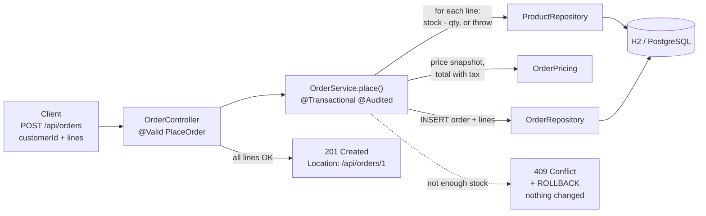

---

## 2. Every file of the challenge

**New** = written for the challenge. **Reused** = from Tasks 1–5, used as it is.

### Main code — `src/main/java/edu/itc/shop/`

| File | New / reused | Layer | What it does | Concept |
|---|---|---|---|---|
| `order/OrderController.java` | new | web | `POST /api/orders` (201 + `Location`), `GET /api/orders` (page), `GET /api/orders/{id}`, `POST /api/orders/{id}/cancel` | `@RestController`, `@Valid`, `@Min`/`@Max` on parameters |
| `order/PlaceOrder.java` | new | web (request) | body of `POST /api/orders`: `customerId` + list of `Line(productId, qty)` | Bean Validation on a record, nested `@Valid` |
| `order/OrderDto.java` | new | web (response) | the JSON returned for an order, with its lines | DTO: what the client sees |
| `order/OrderService.java` | new | service | `place()`, `cancel()`, `list()`, `findById()`: all business rules | `@Transactional`, `@Audited`, constructor injection |
| `order/OrderPricing.java` | new | service (pure) | net = Σ price × qty; total = net × (1 + tax), rounded once | plain Java, unit-testable without Spring |
| `order/OrderRepository.java` | new | repository | SQL for `orders` and `order_line`: insert, find, page, count, guarded status update | `JdbcClient`, named parameters, `LIMIT/OFFSET` |
| `order/Order.java` | new | domain | one row of `orders` | record |
| `order/OrderLine.java` | new | domain | one row of `order_line` (`unitPrice` = price snapshot) | record |
| `order/OrderStatus.java` | new | domain | `NEW`, `PAID`, `CANCELLED` | enum |
| `order/OrderNotFoundException.java` | new | service | unknown order → 404 | extends `common.NotFoundException` |
| `order/OrderNotCancellableException.java` | new | service | order is not `NEW` → 409 | extends `common.ConflictException` |
| `customer/CustomerController.java` | new | web | `GET /api/customers`, `GET /api/customers/{id}` | same layering as orders |
| `customer/CustomerService.java` | new | service | find all / by id (404 if missing) | |
| `customer/CustomerRepository.java` | new | repository | SQL for `customer` | `JdbcClient` → record mapping |
| `customer/Customer.java`, `CustomerNotFoundException.java` | new | domain / service | | |
| `audit/Audited.java` | new | cross-cutting | annotation that marks a method to audit | custom annotation, `@Retention(RUNTIME)` |
| `audit/AuditAspect.java` | new | cross-cutting | logs `AUDIT who what when outcome (ms) request` around every `@Audited` call | AOP `@Around`, `@Order(HIGHEST_PRECEDENCE)` |
| `audit/RequestContext.java` | new | cross-cutting | request id + user (`X-User` header) of the **current** HTTP request | `@RequestScope` bean, scoped proxy |
| `common/NotFoundException.java`, `ConflictException.java`, `InvalidRequestException.java` | new | shared | base exceptions → 404 / 409 / 400 | one rule per status, not per feature |
| `common/Page.java` | new | shared | `{content, page, size, totalElements, totalPages}` | generic record |
| `common/CommonExceptionHandler.java` | new | shared web | turns the exceptions above (and bad parameters / bad JSON) into `ProblemDetail` for the order and customer controllers | `@RestControllerAdvice(basePackages=…)`, `@Order` |
| `repository/ProductRepository.java` | **reused** (Task 3) | repository | `updateStock(id, delta)` = guarded `UPDATE`, `findById` for the price | atomic check-and-change |
| `domain/Product.java` | **reused** (Task 3) | domain | product record | |
| `service/Notifier.java` + `EmailNotifier` / `ConsoleNotifier` | **reused** (Task 2) | service | sends "your order was cancelled" | DI by interface, `@Primary`, `@Profile` |
| `service/InsufficientStockException.java`, `ProductNotFoundException.java` | **reused** (Task 4) | service | not enough stock → 409, unknown product → 404 | |
| `web/ApiExceptionHandler.java` | **reused** (Task 4) | web | body validation errors → 400, stock → 409, product → 404 | `ProblemDetail` |
| `config/ShopProperties.java` | **reused** (Task 5) | config | `shop.tax-rate`, `shop.currency` | `@ConfigurationProperties`, validated |
| `config/AppConfig.java` | **reused** (Task 2) | config | the `Clock` bean (time of `placed_at` and of the audit) | injectable time = testable time |
| `config/RequestIdFilter.java` | **reused** (Task 5) | web | puts a request id into the MDC and the `X-Request-Id` header | servlet filter |

### Resources and build files

| File | What it does |
|---|---|
| `src/main/resources/schema.sql` | H2 tables. The challenge **appended** `customer`, `orders`, `order_line`. |
| `src/main/resources/data.sql` | H2 seed data. The challenge **appended** 3 customers. |
| `src/main/resources/db/postgresql/schema.sql` | PostgreSQL tables (`CREATE TABLE IF NOT EXISTS`), used by `prod`. |
| `src/main/resources/db/postgresql/data.sql` | PostgreSQL seed data (`ON CONFLICT DO NOTHING`), used by `prod`. |
| `src/main/resources/application-prod.yml` | `prod` profile: PostgreSQL driver, URL/user/password from environment variables, the PostgreSQL scripts. |
| `docker-compose.yml` | starts PostgreSQL 17 for `prod`. |
| `pom.xml` | the PostgreSQL driver was added with `<scope>runtime</scope>` (needed to run, not to compile). |

### Tests — `src/test/`

| File | Level | Tests | What it proves |
|---|---|---|---|
| `java/…/order/OrderPricingTest.java` | unit, no Spring | 4 | net, tax, rounding once on the total |
| `java/…/order/OrderServiceTest.java` | unit with Mockito | 9 | duplicate product, unknown customer/product, not enough stock → no order stored, cancel rules, notification, paging maths |
| `java/…/order/OrderRepositoryTest.java` | `@JdbcTest` | 8 | insert + read back, newest first, `LIMIT/OFFSET`, filters, count, guarded status update, foreign key |
| `java/…/customer/CustomerRepositoryTest.java` | `@JdbcTest` | 2 | find all / by id |
| `java/…/repository/ProductStockRepositoryTest.java` | `@JdbcTest` | 4 | the guarded stock update; a product in an order cannot be deleted |
| `java/…/order/OrderControllerTest.java` | `@WebMvcTest` | 16 | 201 + `Location`, every 400/404/409 response, page JSON |
| `java/…/customer/CustomerControllerTest.java` | `@WebMvcTest` | 2 | 200 and 404 |
| `java/…/order/OrderFlowE2ETest.java` | `@SpringBootTest(RANDOM_PORT)` | 4 | real HTTP: place → stock down → cancel → stock back; **409 changes nothing**; paging; audit line |
| `resources/application-test.yml` | config | | `test` profile: new H2 database per test context, uses `data-test.sql` |
| `resources/data-test.sql` | data | | fixed products, customers and 3 orders the tests rely on |

---

## 3. Concept: layers and package by feature

**Layered architecture.** Each layer has one job and only calls the layer below it.

| Layer | Job | Must **not** |
|---|---|---|
| web (`*Controller`) | HTTP: read JSON, validate, choose status code | contain business rules or SQL |
| service (`*Service`) | business rules, transactions | know about HTTP (no status codes, no `HttpServletRequest`) |
| repository (`*Repository`) | SQL only | contain business rules |

**Package by feature.** Everything about orders sits in `order/`, everything about customers in `customer/`, so a
change to "orders" stays in one folder.

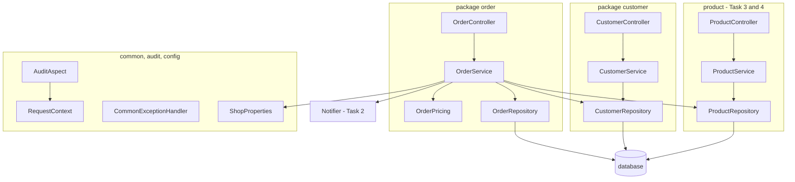

The arrows only go **down** (controller → service → repository → database). `OrderService` may use
`ProductRepository` from another feature, because reserving stock is part of placing an order.

---

## 4. Concept: the data model

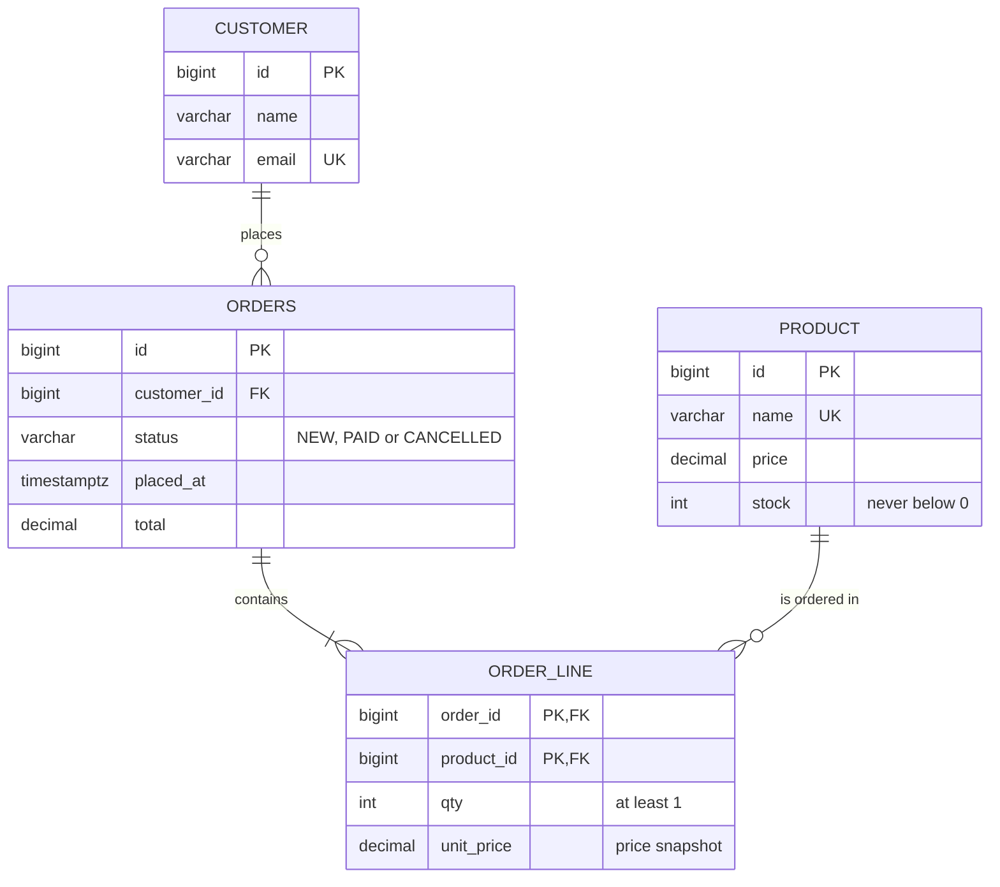

- `order_line` has the primary key `(order_id, product_id)`: the same product cannot appear twice in one order.
- `unit_price` is **copied** from `product.price` when the order is placed. If the price changes tomorrow, old
  orders keep the price the customer paid.
- `CHECK (stock >= 0)` is the database's last safety net; the guarded `UPDATE` ([section 8](#8-concept-guarded-updates-and-two-users-at-the-same-time)) already prevents negative stock.
- The table is called `orders`, not `order`, because `ORDER` is an SQL keyword (`ORDER BY`).

---

## 5. Concept: the life of an order

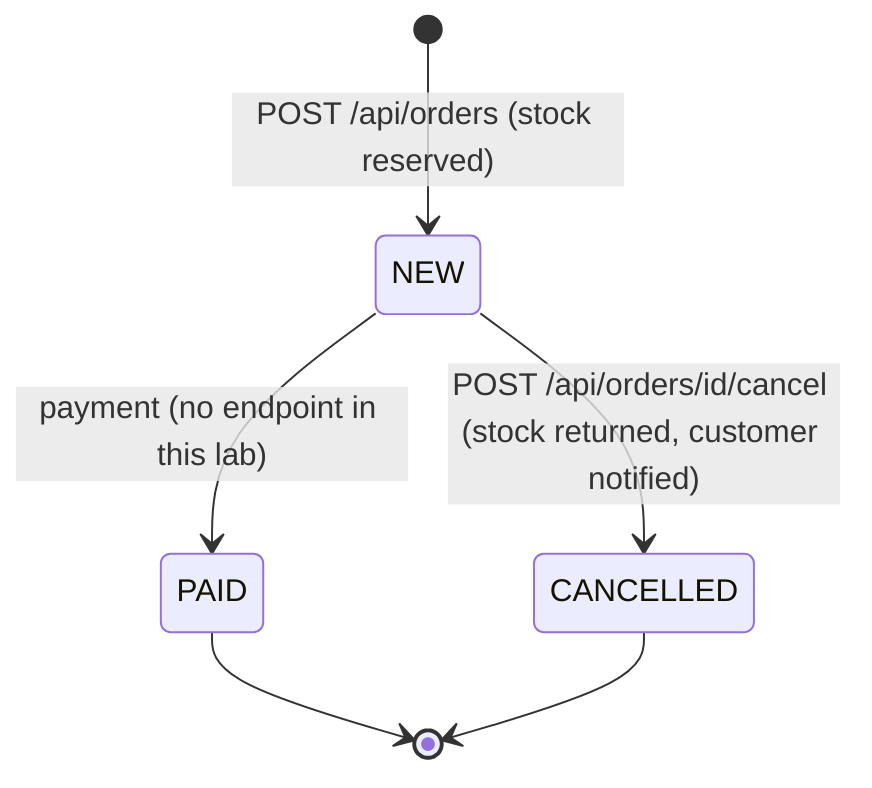

Only `NEW` can be cancelled. Cancelling a `PAID` or `CANCELLED` order answers **409** and changes nothing.
`PAID` exists in the schema and the enum (the lab asks for it), and the test data has a `PAID` order, but there is
no payment endpoint.

---

## 6. Concept: "place order" through all layers

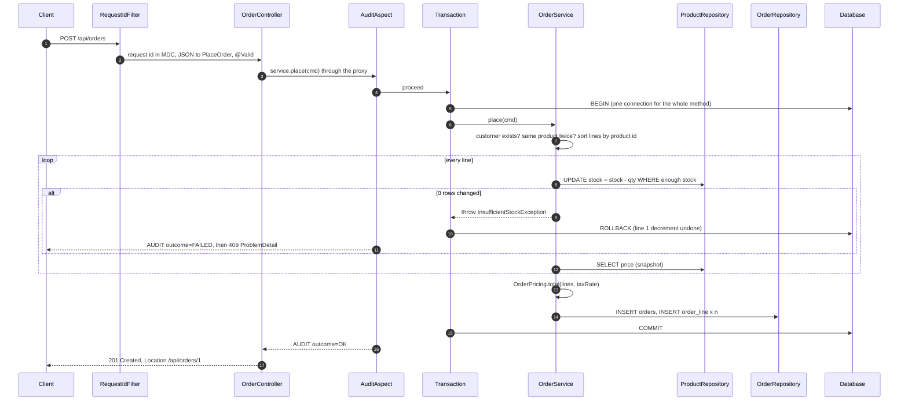

What happens in each file, in order:

1. `config/RequestIdFilter`: creates a request id such as `fc2479b8` and puts it into the log context (MDC).
2. `order/OrderController.place`: Spring turns the JSON into `PlaceOrder` and checks `@NotNull`, `@NotEmpty`, `@Min(1)`. A bad body → **400** before any business code runs.
3. `audit/AuditAspect`: notes who / what / when, then lets the call continue.
4. The transaction interceptor (from `@Transactional`) opens **one** transaction.
5. `order/OrderService.place`: checks the customer, rejects duplicate products, then for every line calls `ProductRepository.updateStock(id, -qty)`.
6. `order/OrderPricing.total`: computes the total with `ShopProperties.taxRate`.
7. `order/OrderRepository.insert`: writes the order and its lines.
8. The transaction **commits**. The aspect logs `outcome=OK`. The controller answers **201** with `Location`.

---

## 7. Concept: the transaction boundary

`@Transactional` does not change the method itself. Spring creates a **proxy** in front of `OrderService`. A call
from the controller goes through the proxy, and the proxy starts and ends the transaction.

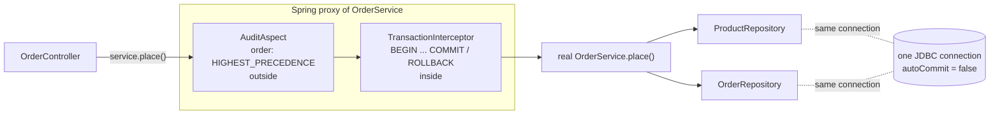

| Where could the transaction be? | Result | Chosen? |
|---|---|---|
| on each **repository** method | every `UPDATE` commits alone; if line 2 fails, line 1 stays decremented → **partial order** | no |
| on the **controller** | works, but the transaction also covers JSON parsing and response writing (holds the connection longer), and other callers of the service (tests, a batch job, the JSP page) get no protection | no |
| on the **service** method | exactly one use case = one unit of work; every caller gets the same all-or-nothing behaviour | **yes** |

Rules to remember:

- **Rollback** happens for `RuntimeException` (all our exceptions extend it).
- A call **inside** the same class (`this.place(…)`) does not go through the proxy, so it gets **no** transaction and **no** audit.
- `list()` and `findById()` use `@Transactional(readOnly = true)`: the count, the page and the lines are read on the same connection.
- `AuditAspect` is **outside** the transaction, so `outcome=OK` is only written after the commit succeeded.
- **Proof:** `OrderFlowE2ETest.lineWithoutEnoughStockIs409AndNothingChanges`. With `@Transactional` removed from `place()`, it fails with `expected: 10 but was: 8` (line 1's stock leaked).

---

## 8. Concept: guarded updates and two users at the same time

**Wrong way (read, then write):** two requests can both read "stock = 1" and both sell it.

**Our way:** check and change in **one** SQL statement. The database runs it atomically.

```sql
-- repository/ProductRepository.updateStock (Task 3), called with delta = -qty
UPDATE product SET stock = stock + :delta
WHERE id = :id AND stock + :delta >= 0      -- returns 1 row changed, or 0 if not enough stock

-- order/OrderRepository.updateStatus, used by cancel
UPDATE orders SET status = 'CANCELLED'
WHERE id = :id AND status = 'NEW'            -- only one of two parallel cancels changes the row
```

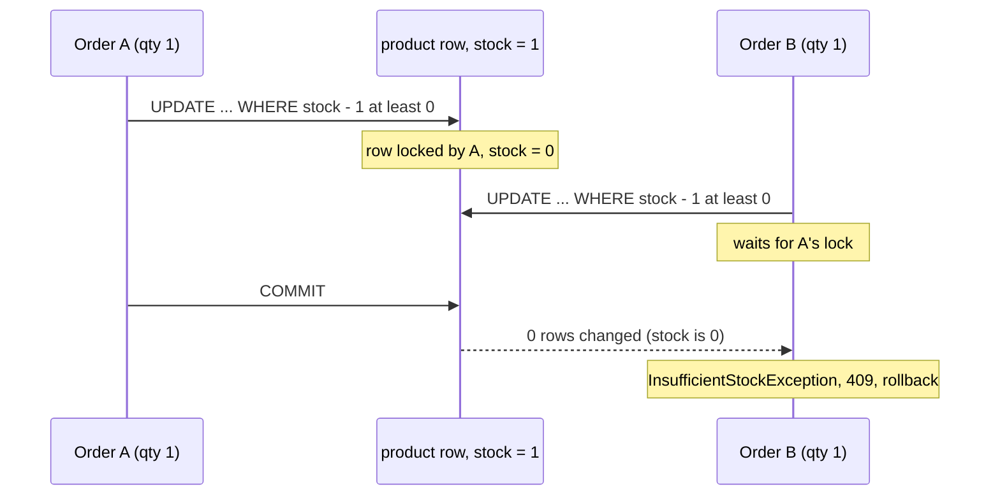

Two more details:

- `OrderService.place` handles the lines **sorted by product id**. Two orders that both want products 2 and 3
  then lock row 2 first and row 3 second, so they cannot block each other forever (no deadlock).
- `cancel()` first runs the guarded status update. If it changes 0 rows, the order is either unknown (**404**) or not
  `NEW` (**409**), and the stock is **not** returned. Stock can never be returned twice.

---

## 9. Concept: price snapshot and total with tax

```
net   = Σ (unitPrice × qty)
total = net × (1 + shop.tax-rate)     rounded HALF_UP to 2 decimals, once, on the total
```

Example with the default data (`tax-rate: 0.10` in `application.yml`):

| Line | Unit price (snapshot) | Qty | Line net |
|---|---|---|---|
| Keyboard (id 3) | 49.99 | 2 | 99.98 |
| Mouse (id 2) | 25.50 | 1 | 25.50 |
| **net** | | | **125.48** |
| × 1.10 | | | 138.028 |
| **total** (rounded) | | | **138.03** |

Why round **once**? Rounding every line first can give a different total:
3 × 0.35 with 10 % tax → per line 0.385 → 0.39, three times = **1.17**; once on the total 1.155 → **1.16**.
`OrderPricingTest.roundingHappensOnceOnTheTotalNotPerLine` checks this.

`OrderPricing` uses only `BigDecimal` and no Spring, so it is tested in milliseconds without a database.
Money is never `double`: `0.1 + 0.2` is not exactly `0.3` in floating point.

---

## 10. Concept: validation at three places

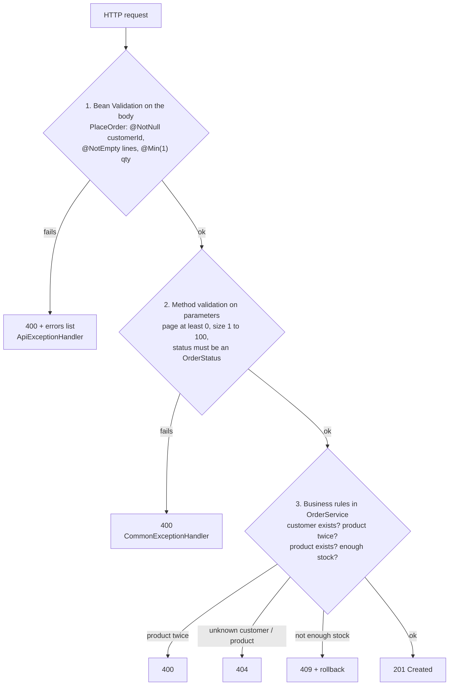

- Levels 1 and 2 only need the request itself, so Spring checks them **before** the service runs (`verifyNoInteractions(service)` in `OrderControllerTest` proves the service is not called).
- Level 3 needs the database, so it lives in the service.

---

## 11. Concept: errors as `ProblemDetail`

Every error answer has the standard RFC 9457 shape, `Content-Type: application/problem+json`:

```json
{"title":"Conflict","status":409,"detail":"Insufficient stock for product 2: 49 available, 999 requested","instance":"/api/orders"}
```

Two `@RestControllerAdvice` classes share the work. Spring asks `CommonExceptionHandler` first (it has
`@Order(HIGHEST_PRECEDENCE)`); what it does not handle goes to `ApiExceptionHandler` from Task 4.

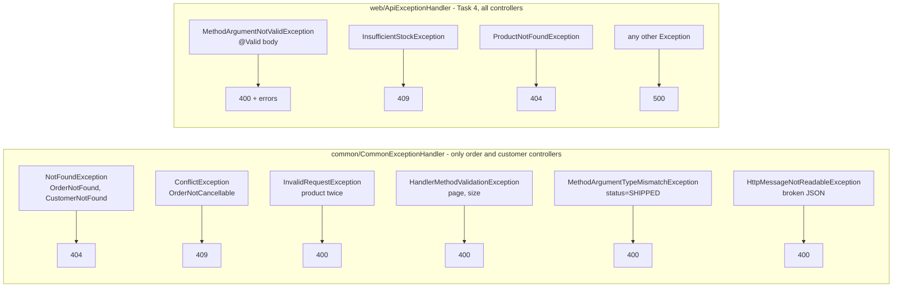

Why a second handler instead of editing `ApiExceptionHandler`? The Task 4 file stays unchanged, and because
`CommonExceptionHandler` is limited to the `order` and `customer` packages, the product endpoints answer exactly as
before.

---

## 12. Concept: AOP audit and the request-scoped bean

**AOP (aspect-oriented programming)** adds the same behaviour (here: an audit log line) to many methods without
copying code into them. You only write `@Audited` on the method.

```java
@Transactional
@Audited
public OrderDto place(PlaceOrder cmd) { … }
```

`AuditAspect` has `@Around("@annotation(edu.itc.shop.audit.Audited)")`: it runs before and after every such method.

**The problem:** `AuditAspect` is a **singleton** (one object for the whole app), but "who is calling" and "which
request" change with **every** HTTP request. **The solution:** `RequestContext` is `@RequestScope`, one object per
request. Spring injects a **scoped proxy** into the aspect, which forwards every call to the current request's object.

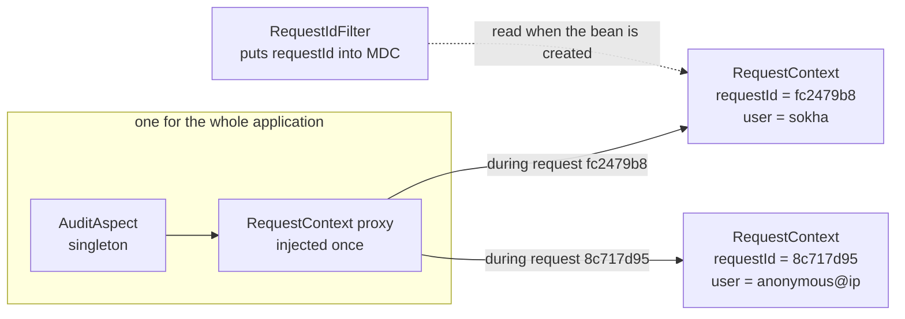

Real log lines (default profile):

```
INFO  [fc2479b8] e.itc.shop.audit.AuditAspect : AUDIT who=sokha what=OrderService.place(PlaceOrder[customerId=1, lines=[…]]) when=2026-10-29T11:52:54.956976681Z outcome=OK result=OrderDto(id=1) (21 ms) request=fc2479b8
WARN  [8c717d95] e.itc.shop.audit.AuditAspect : AUDIT who=anonymous@0:0:0:0:0:0:0:1 what=OrderService.place(…qty=999…) when=… outcome=FAILED error=InsufficientStockException: Insufficient stock for product 2: 49 available, 999 requested (2 ms) request=8c717d95
```

- `who` comes from the `X-User` header (there is no login in this lab).
- Outside an HTTP request (for example if a `CommandLineRunner` or a scheduled job called `place()`) there is no request scope; the aspect then logs `who=system request=-` instead of failing.
- `OrderFlowE2ETest.auditLineHasUserAndRequestId` checks the line and compares the id with the `X-Request-Id` response header.

---

## 13. Concept: paging with `LIMIT` / `OFFSET`

`GET /api/orders?customerId=1&status=NEW&page=2&size=5` reads rows 11–15 of the matching orders, newest first.

```
OFFSET     = page × size                       (page starts at 0)
totalPages = ceil(totalElements / size)
```

```sql
SELECT COUNT(*) FROM orders WHERE customer_id = :customerId AND status = :status;      -- totalElements
SELECT id, customer_id, status, placed_at, total FROM orders
WHERE customer_id = :customerId AND status = :status
ORDER BY placed_at DESC, id DESC LIMIT :limit OFFSET :offset;                         -- one page
SELECT order_id, product_id, qty, unit_price FROM order_line WHERE order_id IN (:orderIds);  -- lines of that page, one query
```

```json
{"content":[{"id":1, "status":"NEW", …}],"page":0,"size":5,"totalElements":1,"totalPages":1}
```

- Each filter is optional. `OrderRepository.where()` only adds **fixed** text such as `customer_id = :customerId`; the values are always **bound parameters**, so there is no SQL injection.
- `size` is limited to 1…100, so nobody can ask for a million rows.
- The lines of all orders on the page come in **one** extra query (`IN (:orderIds)`), not one query per order.

---

## 14. Concept: profiles and databases

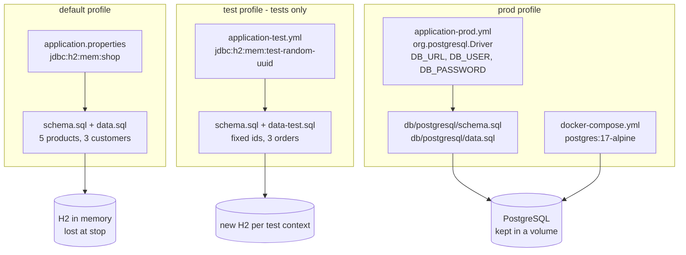

- **Why two schema files?** H2 and PostgreSQL speak slightly different SQL. In H2 2.4, a `CHECK (status IN (…))`
  breaks once the connection that created the table closes (*Check constraint invalid*); the H2 file uses an
  equivalent `CASE` check. PostgreSQL keeps the normal `IN`.
- **Why `runtimeOnly` / `<scope>runtime</scope>` for the driver?** Our code never imports PostgreSQL classes; it
  only uses JDBC interfaces. The driver is only needed when the app runs.
- **Why passwords from environment variables?** A password in a committed file is visible to everyone with the
  repository. `docker-compose.yml` even refuses to start without `DB_PASSWORD`.

---

## 15. Concept: tests at four levels

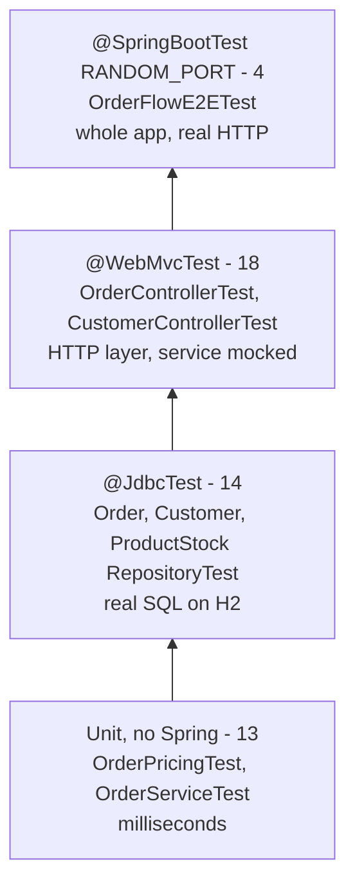

| Level | What starts | What is fake | Good for |
|---|---|---|---|
| unit | nothing, just `new OrderService(mocks…)` | repositories, notifier (Mockito) | business rules, fast feedback |
| `@JdbcTest` | `DataSource`, `JdbcClient`, H2 + `data-test.sql` (rolled back after each test) | no web, no services | is the SQL right? |
| `@WebMvcTest` | controllers, JSON, validation, exception handlers | the service (`@MockitoBean`) | status codes, JSON shape, error bodies |
| `@SpringBootTest(RANDOM_PORT)` | the whole application on a free port | nothing | the layers working together, the transaction |

The numbers above are only the challenge's new tests (49). With the 10 tests from Tasks 1–5 the project has 59.

---

## 16. Demo script (5 minutes)

1. `./mvnw verify` → `Tests run: 59, Failures: 0`, `BUILD SUCCESS`.
2. `./mvnw spring-boot:run`, then in a second terminal:
3. `curl localhost:8080/api/products/3`: Keyboard stock **30**.
4. Place an order (2 × Keyboard, 1 × Mouse) → **201**, `Location: /api/orders/1`, total **138.03**. Stock now **28**.
5. Place an order with 999 × Mouse → **409** `Insufficient stock for product 2…`. Keyboard is **still 28**: "the first line was decremented and then rolled back".
6. `curl "localhost:8080/api/orders?customerId=1&page=0&size=5"`: the page JSON.
7. Cancel order 1 → **200**, `CANCELLED`. Keyboard back to **30**. Show the `EMAIL to=sokha@example.com …` line.
8. Cancel again → **409**.
9. Show the `AUDIT …` lines in the log with `who=sokha` and the request id.
10. Open `OrderService.place` and point at `@Transactional`, then at `OrderFlowE2ETest.lineWithoutEnoughStockIs409AndNothingChanges`.

The exact commands are in [run.md](run.md#challenge-customers-and-orders).

---

## 17. Questions the teacher may ask

**Where is the transaction boundary, and why there?**
On `OrderService.place` and `OrderService.cancel`. One use case = one unit of work. In the repository, each
statement would commit alone (partial orders). In the controller, it would hold the connection during JSON work, and
other callers would not be protected.

**How do you prove that the 409 case changes nothing?**
`OrderFlowE2ETest.lineWithoutEnoughStockIs409AndNothingChanges` reads the stock and the order count over HTTP,
sends an order whose first line is fine and whose second line is too big, then checks that stock and count are the
same. Without `@Transactional` this test fails.

**What if two customers buy the last item at the same time?**
The stock check and the decrement are one `UPDATE … WHERE stock + :delta >= 0`. The database locks the row; the
second update sees stock 0, changes 0 rows, and that order gets 409.

**Why is `AuditAspect` `@Order(HIGHEST_PRECEDENCE)`?**
So it wraps the transaction from the outside. `outcome=OK` is then only logged after a successful commit.

**How can a singleton aspect hold a per-request value?**
It does not hold it. It holds a scoped proxy of the `@RequestScope` bean `RequestContext`; every call is forwarded
to the bean of the current request.

**Why does `@Audited` not work if `OrderService` calls its own method?**
Aspects and transactions live in the Spring proxy. `this.place()` calls the real object directly and skips the proxy.

**Why snapshot the price?**
So an old order always shows what the customer paid, even after the product price changes.

**Why `BigDecimal` and `HALF_UP`?**
`double` cannot store most decimal amounts exactly. `HALF_UP` is the rounding people expect for money (0.005 → 0.01).

**Why is the PostgreSQL driver `runtime` scope?**
The code only uses the JDBC API. The driver is needed only while running in `prod`, not to compile.

**What did you reuse from the earlier tasks?**
`ProductRepository.updateStock` (Task 3), `Notifier` (Task 2), `ApiExceptionHandler` and the product exceptions
(Task 4), `ShopProperties`, `RequestIdFilter` (Task 5) and the `Clock` bean (Task 2).
