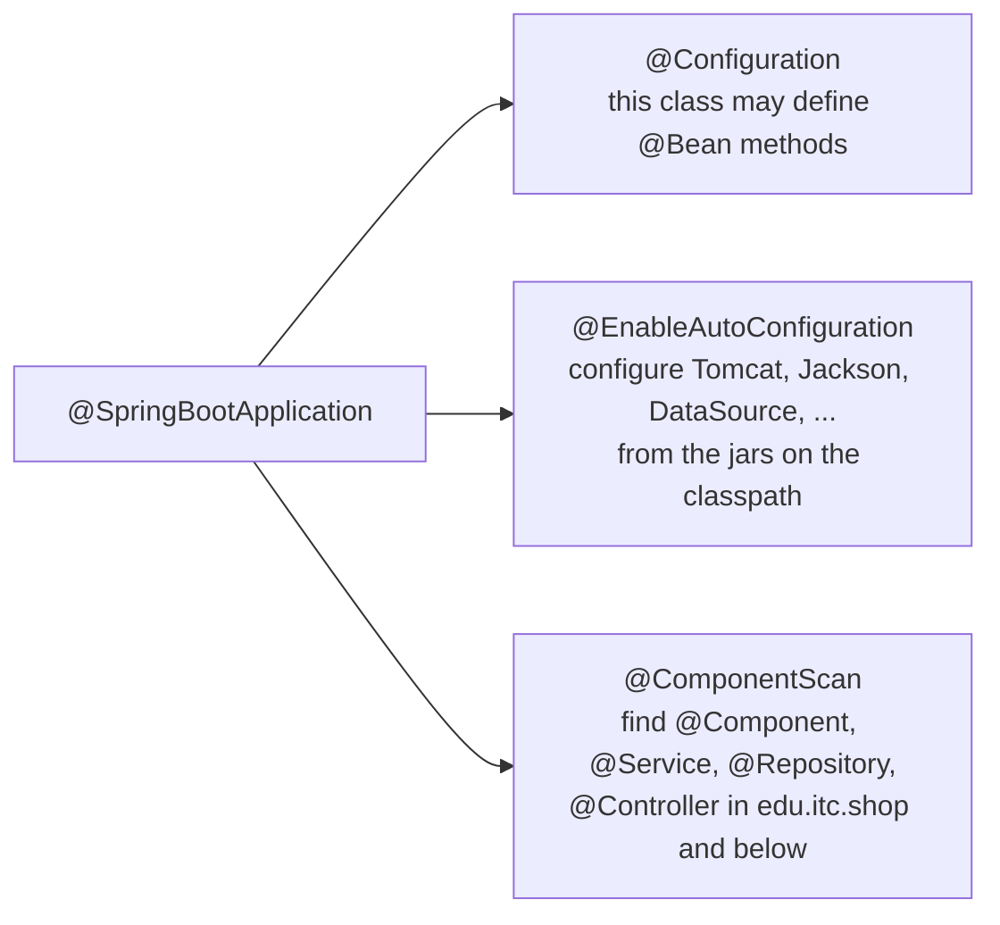
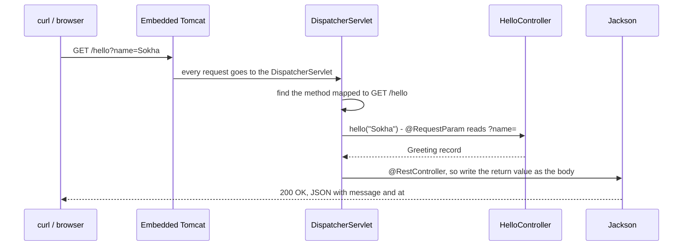

# Task 1 — Spring Boot project and the first REST controller

**Goal:** create the `shop` Spring Boot project and answer an HTTP request with JSON.

| | |
|---|---|
| Commits | `725a549` project created (Spring Initializr), `cecc69c` *Task1 Controller* |
| Run | `./mvnw spring-boot:run`, then `curl localhost:8080/hello` (see [run.md](run.md)) |
| Test | `ShopApplicationTests` |

---

## 1. Files

| File | What it is |
|---|---|
| `pom.xml` | Maven build: parent `spring-boot-starter-parent` 4.1.1, Java 25, the starters (web MVC, JDBC, validation, actuator, H2, …) |
| `mvnw`, `mvnw.cmd`, `.mvn/wrapper/maven-wrapper.properties` | Maven wrapper: downloads Maven 3.10 itself, so nobody has to install Maven |
| `src/main/java/edu/itc/shop/ShopApplication.java` | the `main` method; starts Spring |
| `src/main/java/edu/itc/shop/config/web/HelloController.java` | `GET /hello` (first created in `web/`, moved to `config/web/` later) |
| `src/main/resources/application.properties` | configuration (`spring.application.name=shop`, later also the database) |
| `src/test/java/edu/itc/shop/ShopApplicationTests.java` | test: the whole application context starts |

---

## 2. The code

```java
@SpringBootApplication
public class ShopApplication {
    public static void main(String[] args) {
        SpringApplication.run(ShopApplication.class, args);
    }
}
```

```java
@RestController
public class HelloController {

    public record Greeting(String message, Instant at) {}

    @GetMapping("/hello")
    public Greeting hello(@RequestParam(defaultValue = "world!!") String name) {
        return new Greeting("Hello, " + name + "!", Instant.now());
    }
}
```

---

## 3. Concepts

### `@SpringBootApplication` = three annotations



- **Auto-configuration:** `spring-boot-starter-webmvc` is on the classpath, so Spring Boot creates an embedded
  **Tomcat** on port 8080, a `DispatcherServlet` and a Jackson JSON converter. No XML, no `web.xml`.
- **Component scan:** it starts from the package of `ShopApplication` (`edu.itc.shop`). That is why
  `HelloController` is still found after it moved to `edu.itc.shop.config.web`: it is still *below* `edu.itc.shop`.
  A class in another package, such as `edu.Product` in `backup-misplaced/`, would not be found.

### What happens for `GET /hello?name=Sokha`



| Annotation / type | Meaning |
|---|---|
| `@RestController` | `@Controller` + `@ResponseBody`: the return value **is** the response body (JSON), not a page name |
| `@GetMapping("/hello")` | this method handles `GET /hello` |
| `@RequestParam(defaultValue = "world!!")` | reads `?name=…`; if it is missing, uses `"world!!"` |
| `record Greeting` | an immutable data class; Jackson turns its components into JSON fields |
| `Instant` | a moment in UTC; Jackson writes it as an ISO-8601 text (`2026-10-29T11:58:39.928841194Z`) |

### Starters and the Maven wrapper

A **starter** is one dependency that brings a tested set of libraries, e.g. `spring-boot-starter-webmvc` =
Spring MVC + Tomcat + Jackson. The parent `spring-boot-starter-parent` chooses compatible versions, so the `pom.xml`
has no version numbers for them.

---

## 4. Try it

```bash
./mvnw spring-boot:run
curl localhost:8080/hello
# {"message":"Hello, world!!!","at":"2026-10-29T11:58:39.928841194Z"}
curl "localhost:8080/hello?name=Sokha"
# {"message":"Hello, Sokha!","at":"2026-10-29T11:58:39.937326059Z"}
```

The default gives three `!`: the default value is `"world!!"` and the code adds one more `"!"`.

---

## 5. Test

```java
@SpringBootTest
class ShopApplicationTests {
    @Test
    void contextLoads() { }
}
```

It has no assertion, but it fails if **any** bean cannot be created (missing dependency, two `@Primary` beans, bad
configuration…). It is the cheapest "does the app start at all?" check.

```bash
./mvnw test -Dtest=ShopApplicationTests
```

---

## 6. Notes

- `ServletInitializer.java` (added in Task 5) is only needed to deploy a **war** file into an external Tomcat. The
  project is packaged as a **jar** with Tomcat inside, so it is not used today.
- `src/main/java/edu/itc/shop/Test/test.java` is an empty placeholder class; it does nothing.
