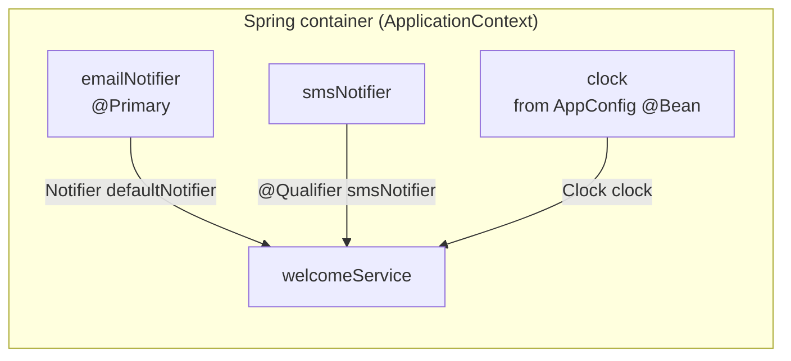
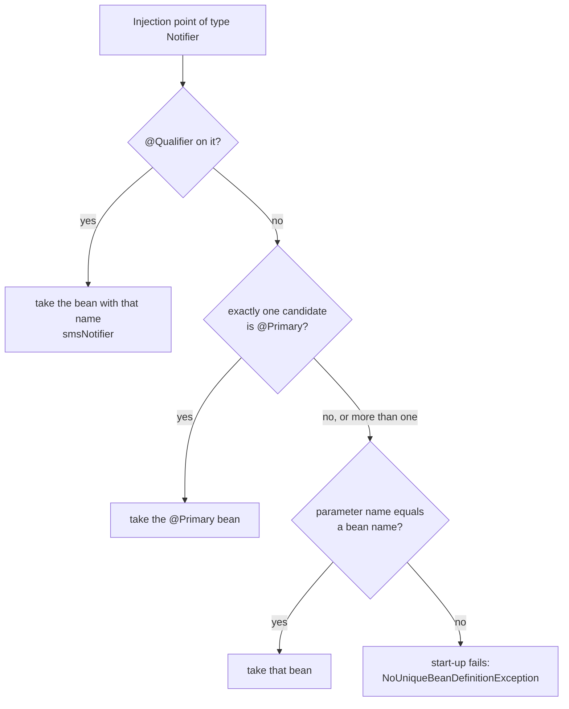
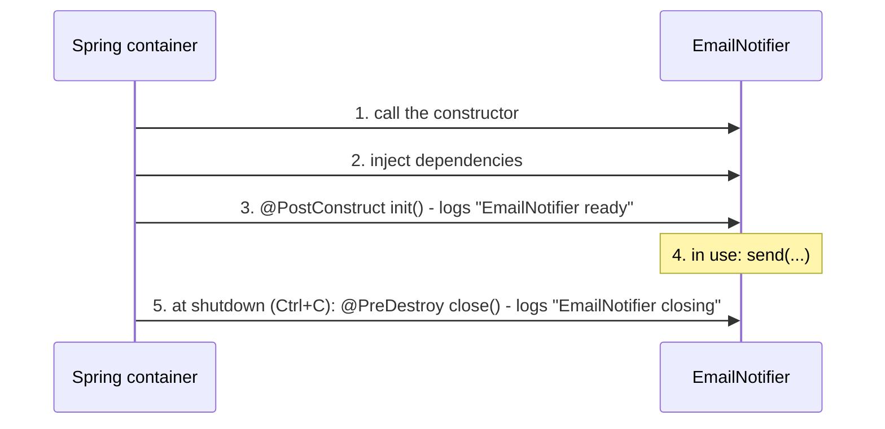

# Task 2 — IoC, dependency injection, qualifiers, profiles, scopes, lifecycle

**Goal:** let Spring create and connect the objects (beans) instead of calling `new` yourself, and control *which*
bean is injected, *how many* instances exist, and *when* they are created and destroyed.

| | |
|---|---|
| Commits | `544bac3` *Task 2: IoC, DI, qualifiers, profiles, scopes, lifecycle*, `a3fd5d6` … `b6d4b0a` (dev profile fix, README) |
| Run | `./mvnw spring-boot:run` and read the start-up log; `-Dspring-boot.run.profiles=dev` for the dev notifier |
| Test | `WelcomeServiceTest` (no Spring) |
| Also explained in | [README.md](README.md), section *Task 2 – Which @Primary wins?* |

---

## 1. Files

| File | Role | Concept |
|---|---|---|
| `service/Notifier.java` | interface `send(to, text)` | program against an interface |
| `service/EmailNotifier.java` | `@Service @Primary @Profile("!dev")`, logs `EMAIL to=…` | `@Primary`, `@Profile`, `@PostConstruct` / `@PreDestroy` |
| `service/SmsNotifier.java` | `@Service`, logs `SMS to=…` | chosen by name with `@Qualifier("smsNotifier")` |
| `service/ConsoleNotifier.java` | `@Service @Profile("dev") @Primary`, prints `CONSOLE to=…` | bean that only exists in the `dev` profile |
| `service/WelcomeService.java` | uses two notifiers and a `Clock` | constructor injection, `@Qualifier` |
| `service/ReportBuilder.java` | `@Component @Scope("prototype")` | a **new** instance every time |
| `config/AppConfig.java` | `@Configuration` with `@Bean Clock clock()` | creating a bean from a method |
| `DemoRunner.java` | `CommandLineRunner`: runs once after start-up and shows everything in the log | `ApplicationContext`, `ObjectProvider` |
| `test/…/service/WelcomeServiceTest.java` | unit test with a fake notifier and a fixed clock | why DI makes testing easy |

`DemoRunner` was first a `@Bean CommandLineRunner` method inside `ShopApplication`; it was moved to its own class
during Task 4.

---

## 2. Concepts

### IoC and dependency injection

**Without Spring**, `WelcomeService` would create its helpers itself: `new EmailNotifier()`, `new SmsNotifier()`.
It would be glued to those classes and hard to test.

**With Spring (Inversion of Control)**, the class only *asks* for what it needs in its constructor, and the Spring
container *gives* it the beans:

```java
@Service
public class WelcomeService {
    private final Notifier defaultNotifier;
    private final Notifier urgentNotifier;
    private final Clock clock;

    public WelcomeService(Notifier defaultNotifier,
                          @Qualifier("smsNotifier") Notifier urgentNotifier,
                          Clock clock) { … }
}
```



**Constructor injection** (used everywhere in this project) means: the fields can be `final`, the object is never
half-built, and a test can call the constructor with fakes.

### Which `Notifier` is injected?

There are several beans of type `Notifier`. Spring decides like this:



### Profiles

| Profile | Beans of type `Notifier` | `@Primary` | `defaultNotifier` gets | `urgentNotifier` gets |
|---|---|---|---|---|
| default (none) | `emailNotifier`, `smsNotifier` | `emailNotifier` | `EmailNotifier` | `SmsNotifier` |
| `dev` | `consoleNotifier`, `smsNotifier` | `consoleNotifier` | `ConsoleNotifier` | `SmsNotifier` |

The bug the team found and fixed: at first `EmailNotifier` had no `@Profile`. With `dev`, **both** `EmailNotifier`
and `ConsoleNotifier` were `@Primary`, and the start failed with *more than one 'primary' bean found*.
`@Profile("!dev")` ("every profile except dev") on `EmailNotifier` leaves exactly one `@Primary` per profile.

### Scopes: singleton vs prototype

| Scope | How many instances | Example |
|---|---|---|
| **singleton** (default) | one for the whole application | `WelcomeService`, all notifiers |
| **prototype** | a new one every time it is requested | `ReportBuilder`, because it keeps state (a `StringBuilder`) that must not be shared |

```java
ReportBuilder first = reports.getObject();     // reports is an ObjectProvider<ReportBuilder>
ReportBuilder second = reports.getObject();
log.info("prototype instances differ: {}",
        System.identityHashCode(first) != System.identityHashCode(second));   // true
```

`ObjectProvider` is needed because a singleton (`DemoRunner`) is created only once. If it injected
`ReportBuilder` directly, it would get one instance forever. `getObject()` asks the container again each time.

### Bean lifecycle



Spring does **not** call `@PreDestroy` on prototype beans: after handing one out, the container forgets it.

### A bean from a `@Bean` method

```java
@Configuration
public class AppConfig {
    @Bean
    public Clock clock() { return Clock.systemDefaultZone(); }
}
```

`Clock` is a JDK class, so it cannot carry `@Component`. A `@Bean` method creates it. Because the time comes from an
injected `Clock` instead of `LocalTime.now()`, a test can pass a **fixed** clock.

---

## 3. Try it

```bash
./mvnw spring-boot:run
```

```
INFO  e.i.shop.service.EmailNotifier : EmailNotifier ready
INFO  e.itc.shop.service.SmsNotifier : SmsNotifier ready
INFO  edu.itc.shop.DemoRunner        : 401 beans; notifiers = [… emailNotifier, smsNotifier, …]
INFO  e.i.shop.service.EmailNotifier : EMAIL to=ann text=Welcome ann! It is 18:59:16
INFO  e.itc.shop.service.SmsNotifier : SMS to=bob text=Welcome bob! It is 18:59:16
INFO  edu.itc.shop.DemoRunner        : prototype instances differ: true
```

```bash
./mvnw spring-boot:run -Dspring-boot.run.profiles=dev
```

```
INFO  edu.itc.shop.ShopApplication   : The following 1 profile is active: "dev"
INFO  edu.itc.shop.DemoRunner        : 401 beans; notifiers = [consoleNotifier, … smsNotifier, …]
CONSOLE to=ann text=Welcome ann! It is 18:59:54
INFO  e.itc.shop.service.SmsNotifier : SMS to=bob text=Welcome bob! It is 18:59:54
```

The bean list also shows some `…Notifier…` beans of Spring Boot Admin (a library in `pom.xml`). They are not ours;
the filter in `DemoRunner` simply matches every bean name that contains "Notifier".

---

## 4. Test

`WelcomeServiceTest` creates `WelcomeService` with `new`, with **no Spring at all**:

```java
static class RecordingNotifier implements Notifier {          // a fake: remembers calls instead of sending
    final List<String> calls = new ArrayList<>();
    public void send(String to, String text) { calls.add(to + "|" + text); }
}

Clock fixed = Clock.fixed(Instant.parse("2026-10-28T09:15:02Z"), ZoneOffset.UTC);
var service = new WelcomeService(normal, urgent, fixed);
assertEquals("Welcome ann! It is 09:15:02", service.welcome("ann", false));
```

| Test | Checks |
|---|---|
| `normalWelcomeUsesDefaultNotifier` | the normal notifier got the message, the urgent one nothing |
| `urgentWelcomeUsesUrgentNotifier` | the other way round |

```bash
./mvnw test -Dtest=WelcomeServiceTest
```

This is the main benefit of DI: because the service receives its dependencies, the test can give it fakes and a
fixed time, and the result is always the same.

---

## 5. Used later

The challenge reuses `Notifier` (the cancel e-mail, `EMAIL to=sokha@example.com …`) and the `Clock` bean (the
`placed_at` time of an order and the time in the audit log). See [challenge.md](challenge.md).
