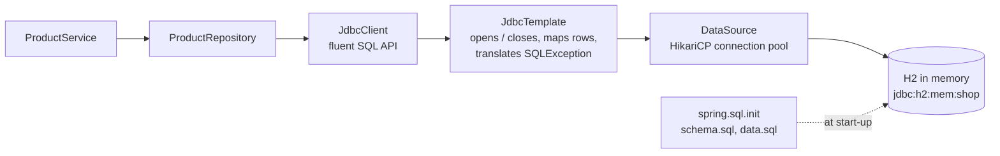
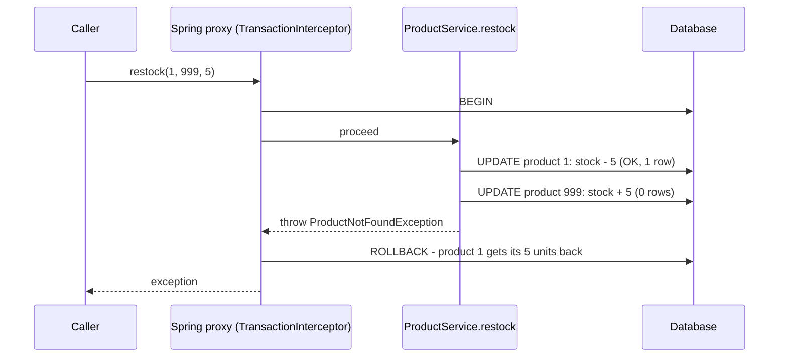

# Task 3 — Database access with JDBC, `JdbcClient` and transactions

**Goal:** store products in a relational database, read and change them with SQL through Spring, and make a
multi-step change atomic with `@Transactional`.

| | |
|---|---|
| Commits | `cba2275` *Jdbc*; cleaned up in `e718229` (classes moved to `domain/` and `repository/`, first versions kept in `backup-misplaced/`) |
| Run | `./mvnw spring-boot:run`, then the H2 console <http://localhost:8080/h2-console> (see [run.md](run.md#task-3-database-with-jdbcclient)) |
| Tests | `Test/RepositoryTest.java` (class `ProductRepositoryTest`, `@JdbcTest`), `Test/ProductServiceTest` (`@SpringBootTest`) |

---

## 1. Files

| File | Role |
|---|---|
| `src/main/resources/schema.sql` | `CREATE TABLE product (id, name UNIQUE, price DECIMAL(10,2), stock CHECK (stock >= 0))` |
| `src/main/resources/data.sql` | 5 products: Laptop, Mouse, Keyboard, Monitor, Headphones |
| `src/main/resources/application.properties` | `spring.datasource.url=jdbc:h2:mem:shop`, user `sa`, `spring.sql.init.mode=always`, H2 console on |
| `domain/Product.java` | `record Product(Long id, String name, BigDecimal price, int stock)` |
| `repository/ProductRepository.java` | all SQL for `product`, written with `JdbcClient` |
| `service/ProductService.java` | `restock(fromId, toId, qty)` with `@Transactional` (more methods were added in Task 4) |
| `backup-misplaced/RawJdbcProductRepository.java` | the same `findAll` in **plain JDBC**, for comparison (not compiled: outside `src/`) |
| `backup-misplaced/ProductRepository.java`, `Product.java` | the first version (positional `?` parameters, `JdbcTemplate` insert), kept for reference |
| `test/…/Test/RepositoryTest.java` | `@JdbcTest` of the repository |
| `test/…/Test/ProductServiceTest.java` | `@SpringBootTest` of `restock` |

---

## 2. Concepts

### From the application to the database



- **`DataSource` + HikariCP:** Spring Boot creates a connection pool from `spring.datasource.*`. Opening a database
  connection is slow, so the pool keeps a few open and lends them out.
- **H2 in memory:** the database lives in RAM and disappears when the app stops. Good for learning and tests.
- **SQL init:** with `spring.sql.init.mode=always`, Spring runs `schema.sql`, then `data.sql`, at every start.

### Three ways to write the same query

| | Plain JDBC (`RawJdbcProductRepository`) | `JdbcTemplate` | `JdbcClient` (used) |
|---|---|---|---|
| Open / close connection | you (`try-with-resources`) | Spring | Spring |
| `SQLException` | you catch it | translated to Spring's `DataAccessException` | translated |
| Map a row to `Product` | `rs.getLong("id")`, `rs.getString(…)`, … by hand | a `RowMapper` | `.query(Product.class)` maps columns to record components by name |
| Parameters | `?` + `setString(1, …)` | `?` | **named** `:id`, `:name` |

```java
// plain JDBC: about 20 lines for one query
try (Connection conn = dataSource.getConnection();
     Statement stmt = conn.createStatement();
     ResultSet rs = stmt.executeQuery(sql)) {
    while (rs.next()) {
        products.add(new Product(rs.getLong("id"), rs.getString("name"),
                rs.getBigDecimal("price"), rs.getInt("stock")));
    }
} catch (SQLException e) { throw new RuntimeException(e); }

// JdbcClient: the same in 3 lines
return jdbc.sql("SELECT id, name, price, stock FROM product ORDER BY id")
        .query(Product.class)
        .list();
```

### Bound parameters (no SQL injection)

```java
jdbc.sql("SELECT id, name, price, stock FROM product WHERE LOWER(name) LIKE LOWER(:name) ORDER BY id")
    .param("name", "%" + name + "%")
```

The user's text is **sent as a value**, never glued into the SQL string. Input like `x' OR '1'='1` is then just a
strange product name, not SQL code.

### Generated keys

```java
var keys = new GeneratedKeyHolder();
jdbc.sql("INSERT INTO product(name, price, stock) VALUES (:name, :price, :stock)") … .update(keys);
return keys.getKey().longValue();          // the id the database generated (IDENTITY column)
```

### Guarded update: check and change in one statement

```sql
UPDATE product SET stock = stock + :delta
WHERE id = :id AND stock + :delta >= 0
```

`update()` returns the number of changed rows: **1** = done, **0** = product missing *or* not enough stock. There is
no gap between "read the stock" and "write the stock", so two parallel requests cannot both take the last item.
The first version (`backup-misplaced/ProductRepository.java`) had no `AND stock + ? >= 0`; the final one has it.
The challenge's orders rely on exactly this method.

### `@Transactional`: all steps or none

`restock(fromId, toId, qty)` moves stock from one product to another: two `UPDATE`s that belong together.



- Spring wraps `ProductService` in a **proxy**; the proxy opens the transaction, the method runs, the proxy commits
  or rolls back.
- A **`RuntimeException`** causes a rollback; a normal return causes a commit.
- All `JdbcClient` calls inside the method use the **same connection**, so they are in the same transaction.

### Exception translation

Spring turns database errors into its own unchecked exceptions, independent of the database. Inserting a second
"Laptop" breaks `name UNIQUE` and becomes a `DuplicateKeyException`, which Task 4 maps to **409**.

---

## 3. Try it

1. `./mvnw spring-boot:run`
2. Open <http://localhost:8080/h2-console>. JDBC URL `jdbc:h2:mem:shop`, user `sa`, empty password → **Connect**.
3. Run:

```sql
SELECT * FROM product;
UPDATE product SET stock = stock - 100 WHERE id = 1 AND stock - 100 >= 0;   -- "0 rows": the guard works
```

Through the REST API of Task 4: `curl localhost:8080/api/products`.

---

## 4. Tests

| Test | Kind | Checks |
|---|---|---|
| `ProductRepositoryTest.findAllReturnsSeedData` | `@JdbcTest` + `@Import(ProductRepository.class)` | the 5 rows from `data.sql` are read |
| `ProductRepositoryTest.findByNameContainingWorks` | `@JdbcTest` | `"top"` finds `Laptop` |
| `ProductServiceTest.rollbackWhenQuantityTooLarge` | `@SpringBootTest` | `restock(1, 2, 10_000)` throws, and both stocks are unchanged |

```bash
./mvnw test -Dtest='ProductRepositoryTest,ProductServiceTest'
```

**`@JdbcTest`** starts only the database part of Spring (`DataSource`, `JdbcClient`, SQL init), not the web layer,
and rolls back every test. That makes it fast and keeps the tests independent.

> **Tip, to make the rollback test stronger:** with `restock(1, 2, 10_000)` the *first* `UPDATE` already fails
> (not enough stock), so nothing was changed before the exception. The test would pass even without
> `@Transactional`. A call where the first step succeeds and the second fails, e.g. `restock(1, 999, 1)` (product
> 999 does not exist), really proves that the first `UPDATE` is rolled back. The challenge test
> `OrderFlowE2ETest.lineWithoutEnoughStockIs409AndNothingChanges` does exactly that for orders.

---

## 5. Used later

- Task 4 puts a REST API on top of `ProductService` / `ProductRepository`.
- The challenge reserves stock with `ProductRepository.updateStock` and adds the tables `customer`, `orders`,
  `order_line` to `schema.sql` (see [challenge.md](challenge.md#4-concept-the-data-model)).
