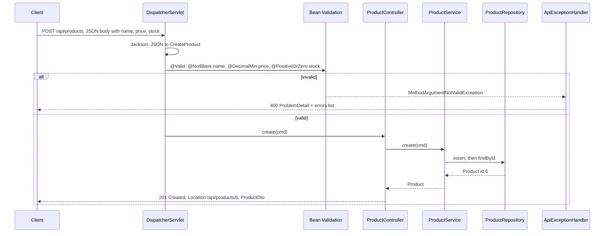
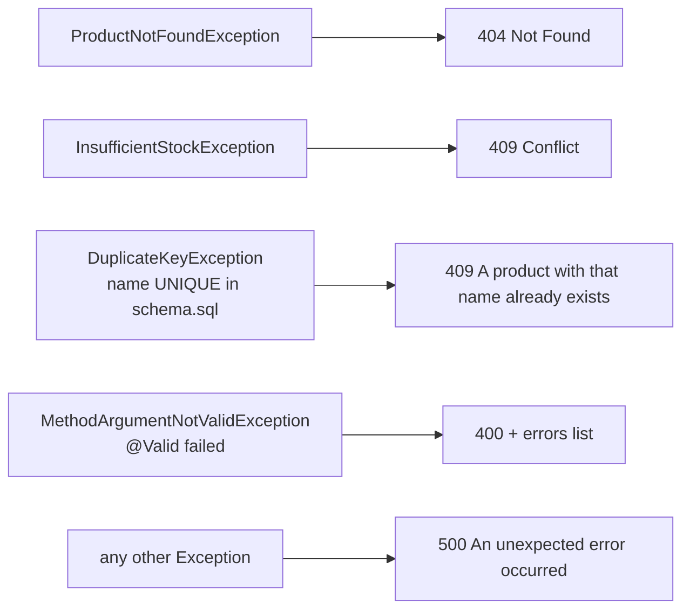
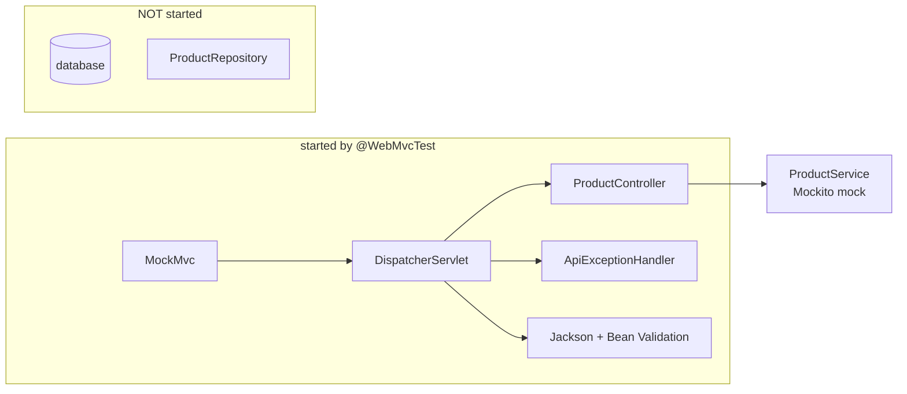

# Task 4 — Product REST API, validation, error handling and controller tests

**Goal:** expose the products of Task 3 as a REST API with the right HTTP methods and status codes, validate the
input, return clear error bodies, and test the web layer on its own.

| | |
|---|---|
| Commit | `e718229` *Implement product REST API and tests* |
| Run | `./mvnw spring-boot:run`, then the `curl` commands below (also in [run.md](run.md#task-4-product-rest-api)) |
| Test | `web/ProductControllerTest` (`@WebMvcTest`) |

---

## 1. Files

| File | Layer | Role |
|---|---|---|
| `web/ProductController.java` | web | the endpoints under `/api/products` |
| `web/dto/CreateProduct.java` | web (input) | body of `POST`, with validation annotations |
| `web/dto/ProductDto.java` | web (output) | what the client receives |
| `web/ApiExceptionHandler.java` | web | turns exceptions into `ProblemDetail` error responses |
| `service/ProductService.java` | service | `findAll`, `search`, `findById`, `create`, `adjustStock`, `delete`, `restock` |
| `service/ProductNotFoundException.java` | service | → 404 |
| `service/InsufficientStockException.java` | service | → 409 |
| `repository/ProductRepository.java`, `domain/Product.java` | repository / domain | from Task 3 |
| `test/…/web/ProductControllerTest.java` | test | 4 web-layer tests |

---

## 2. The API

| Method and path | Body | Success | Errors |
|---|---|---|---|
| `GET /api/products` | | 200, list | |
| `GET /api/products?q=mo` | | 200, products whose name contains "mo" (any case) | |
| `GET /api/products/{id}` | | 200, one product | 404 |
| `POST /api/products` | `{"name","price","stock"}` | **201** + `Location: /api/products/{id}` | 400 invalid fields, 409 name already used |
| `PATCH /api/products/{id}/stock` | `{"delta": -3}` | 200, product with the new stock | 404, 409 stock would go below 0 |
| `DELETE /api/products/{id}` | | **204** no content | 404 |

### Why these methods and codes

| | Meaning | Used for |
|---|---|---|
| `GET` | read, changes nothing, can be repeated | list, one product |
| `POST` | create a new resource | new product |
| `PATCH` | change **part** of a resource | the stock only |
| `DELETE` | remove | delete |
| 200 OK | success with a body | |
| 201 Created + `Location` | a new resource exists at this URL | `POST` |
| 204 No Content | success, nothing to return | `DELETE` |
| 400 Bad Request | the client sent wrong data | validation |
| 404 Not Found | that id does not exist | |
| 409 Conflict | valid request, but it clashes with the current state | duplicate name, not enough stock |

---

## 3. Concepts

### Request → validation → controller → service → repository



### DTO vs domain object

```java
public record CreateProduct(@NotBlank @Size(max = 80) String name,
                            @NotNull @DecimalMin("0.01") BigDecimal price,
                            @PositiveOrZero int stock) {}       // what the client may SEND (no id)

public record ProductDto(long id, String name, BigDecimal price, int stock) {
    public static ProductDto from(Product p) { … }               // what the client RECEIVES
}
```

The client never sends an `id` (the database chooses it), and the domain `Product` can change later without
breaking the JSON contract. Input and output are separate types for that reason.

### `ResponseEntity` for status and headers

```java
@PostMapping
public ResponseEntity<ProductDto> create(@RequestBody @Valid CreateProduct cmd) {
    ProductDto created = ProductDto.from(service.create(cmd));
    return ResponseEntity.created(URI.create("/api/products/" + created.id())).body(created);   // 201 + Location
}

@DeleteMapping("/{id}")
public ResponseEntity<Void> delete(@PathVariable long id) {
    service.delete(id);
    return ResponseEntity.noContent().build();                                                   // 204
}
```

### One place for errors: `@RestControllerAdvice` + `ProblemDetail`

Services throw meaningful exceptions; they know nothing about HTTP. One class turns them into responses with the
standard RFC 9457 shape (`application/problem+json`):



```json
{"title":"Not Found","status":404,"detail":"Product not found: 99","instance":"/api/products/99"}
```

The 500 answer does **not** show the Java exception text to the client: internal details stay in the log.

### Testing only the web layer: `@WebMvcTest`

```java
@WebMvcTest(ProductController.class)
class ProductControllerTest {
    @Autowired MockMvc mvc;              // sends fake HTTP requests, no real server
    @MockitoBean ProductService service; // the real service is replaced by a Mockito mock

    @Test
    void createReturns201AndLocation() throws Exception {
        when(service.create(any())).thenReturn(new Product(6L, "USB-C cable", new BigDecimal("7.90"), 25));
        mvc.perform(post("/api/products")
                .contentType(MediaType.APPLICATION_JSON)
                .content("""
                    {"name":"USB-C cable","price":7.90,"stock":25}
                    """))
           .andExpect(status().isCreated())
           .andExpect(header().string("Location", "/api/products/6"));
    }
}
```



| Test | Checks |
|---|---|
| `listReturns200` | `GET /api/products` → 200, JSON `$[0].name` |
| `missingProductReturns404` | the service throws `ProductNotFoundException` → 404 problem detail |
| `invalidCreateReturns400WithThreeFieldErrors` | empty name, price 0, stock −1 → 400 with **3** errors, and `verifyNoInteractions(service)`: the service was never called |
| `createReturns201AndLocation` | 201 + `Location` + body |

```bash
./mvnw test -Dtest=ProductControllerTest
```

---

## 4. Try it (real output)

```console
$ curl "localhost:8080/api/products?q=mo"
[{"id":2,"name":"Mouse","price":25.50,"stock":50},{"id":4,"name":"Monitor","price":299.99,"stock":15}]

$ curl -i localhost:8080/api/products/99
HTTP/1.1 404
{"detail":"Product not found: 99","instance":"/api/products/99","status":404,"title":"Not Found"}

$ curl -i -X POST localhost:8080/api/products -H 'Content-Type: application/json' -d '{"name":"USB-C cable","price":7.90,"stock":25}'
HTTP/1.1 201
Location: /api/products/6
{"id":6,"name":"USB-C cable","price":7.90,"stock":25}

$ curl -X POST localhost:8080/api/products -H 'Content-Type: application/json' -d '{"name":"","price":0,"stock":-1}'
{"detail":"Request validation failed","instance":"/api/products","status":400,"title":"Bad Request",
 "errors":["price: must be greater than or equal to 0.01","stock: must be greater than or equal to 0","name: must not be blank"]}

$ curl -X POST localhost:8080/api/products -H 'Content-Type: application/json' -d '{"name":"Laptop","price":1,"stock":1}'
{"detail":"A product with that name already exists","instance":"/api/products","status":409,"title":"Conflict"}

$ curl -X PATCH localhost:8080/api/products/1/stock -H 'Content-Type: application/json' -d '{"delta":-3}'
{"id":1,"name":"Laptop","price":1200.00,"stock":7}

$ curl -X PATCH localhost:8080/api/products/1/stock -H 'Content-Type: application/json' -d '{"delta":-100}'
{"detail":"Stock adjustment would result in negative stock","instance":"/api/products/1/stock","status":409,"title":"Conflict"}

$ curl -i -X DELETE localhost:8080/api/products/6
HTTP/1.1 204
```

---

## Known problems

All checked on the running application. None of them was changed, so that the Task 4 code stays as the team wrote it.

| Problem | Why | Possible fix |
|---|---|---|
| An unknown URL such as `/abc` answers **500**, not 404 | `@ExceptionHandler(Exception.class)` also catches Spring's `NoResourceFoundException` | add a handler for `NoResourceFoundException` → 404, or let the advice extend `ResponseEntityExceptionHandler` |
| Broken JSON (`{"name":`) or a `PATCH` body without `delta` (`{}`) answers **500**, not 400 | the same catch-all receives `HttpMessageNotReadableException` | a handler for `HttpMessageNotReadableException` → 400 (the challenge's `CommonExceptionHandler` does this for orders) |
| Deleting a product that is part of an order answers **500**, not 409 (the product is kept) | the foreign key from `order_line` raises `DataIntegrityViolationException`, which only the catch-all handles | a handler for `DataIntegrityViolationException` → 409 |
| `POST /api/products` is expected to fail on PostgreSQL (`prod`) | `insert` calls `update(keys)` without naming the key column; the PostgreSQL driver then returns all columns as keys ("multiple keys") | `update(keys, "id")`, as `OrderRepository` does |
