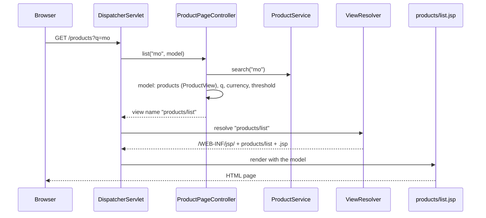
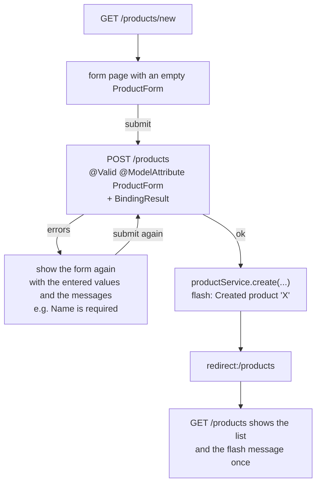
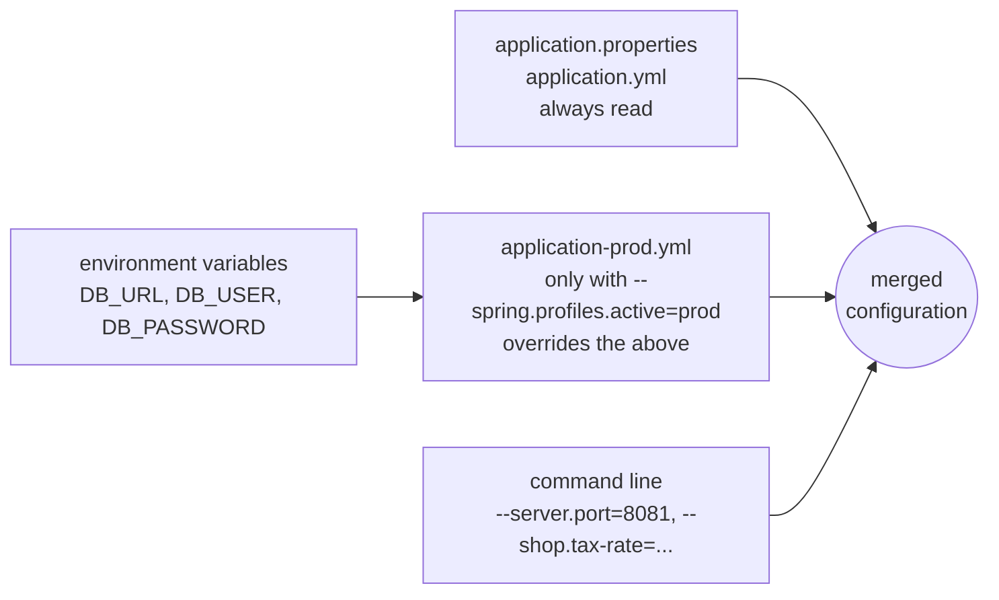
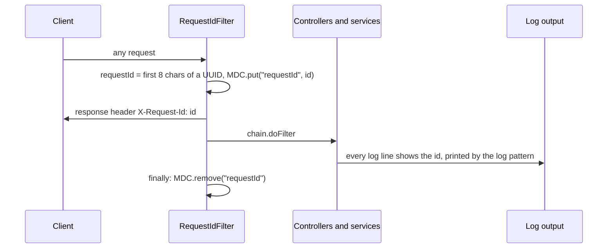
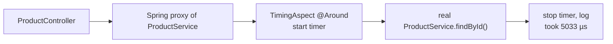

# Task 5 — JSP views, configuration properties, profiles, Actuator, logging, timing aspect

**Goal:** add server-rendered product pages, move settings into type-safe configuration, prepare profiles for
development and production, make the application observable (Actuator health/metrics, a request id in every log
line), and measure service calls with an aspect.

| | |
|---|---|
| Commits | `608c1b9` *Task 5: JSP views, profiles, Actuator, logging, timing aspect*, `92d83f2` *adjust task 5* (AspectJ starter, fixes) |
| Run | `./mvnw spring-boot:run`, then the commands below (also in [run.md](run.md#task-5-configuration-actuator-logging)) |
| Tests | no Task 5 test class; `ShopApplicationTests` checks that the context, with all these beans, starts |

---

## 1. Files

| File | Part | Role |
|---|---|---|
| `web/ProductPageController.java` | MVC views | `GET /products` (list + search), `GET /products/new` (form), `POST /products` (save) |
| `web/ProductForm.java` | MVC views | form object with getters/setters and validation messages |
| `web/ProductView.java` | MVC views | view model: price **and gross price** (price × (1 + tax)) |
| `src/main/resources/site.css` | MVC views | styles for the pages (low-stock rows, flash message, errors) |
| `config/ShopProperties.java` | configuration | `record` bound to `shop.*`: `currency`, `taxRate`, `lowStockThreshold`, validated |
| `config/ShopConfig.java` | configuration | `@EnableConfigurationProperties(ShopProperties.class)` |
| `src/main/resources/application.yml` | configuration | view prefix/suffix, `shop.*`, Actuator exposure, `info.*`, log pattern |
| `src/main/resources/application-prod.yml` | profiles | `prod`: database from `DB_URL` / `DB_USER` / `DB_PASSWORD`, H2 console off, fewer health details |
| `src/main/resources/application_Dev.yml` | profiles | meant for `dev`: DEBUG logging (see [known problems](#known-problems)) |
| `actuator/LowStockHealthIndicator.java` | Actuator | custom health check: DOWN if a product's stock is below the threshold |
| `config/RequestIdFilter.java` | logging | servlet filter: request id → MDC + `X-Request-Id` header |
| `service/TimingAspect.java` | AOP | logs how long every public service method took (DEBUG) |
| `ServletInitializer.java` | deployment | lets the app run as a **war** in an external Tomcat |
| `pom.xml` | build | `spring-boot-starter-aspectj` added for the aspect |

---

## 2. Concepts

### a) Server-side views (MVC with a view name)

A `@RestController` (Task 4) returns **data**. A `@Controller` returns the **name of a page**; a view resolver turns
the name into a file, and the page is filled with the model.



```yaml
spring:
  mvc:
    view:
      prefix: /WEB-INF/jsp/
      suffix: .jsp
```

`ProductView` is a **view model**: it has the values the page needs in ready form (for example the gross price, so
the JSP does no arithmetic):

```java
BigDecimal gross = p.price().multiply(BigDecimal.ONE.add(taxRate)).setScale(2, RoundingMode.HALF_UP);
```

### b) Forms: binding, validation and Post/Redirect/Get



- `@ModelAttribute` fills `ProductForm` from the HTML form fields (that is why it has setters).
- `BindingResult` must come **right after** the validated object; then validation errors do not throw an exception
  but are given to the method, which shows the form again.
- **Post/Redirect/Get:** after a successful `POST` the browser is sent to `GET /products`. Pressing F5 then reloads
  the list and does **not** create the product twice. The flash attribute survives exactly one redirect.

### c) Type-safe configuration with `@ConfigurationProperties`

```yaml
shop:
  currency: USD
  tax-rate: 0.10
  low-stock-threshold: 5
```

```java
@Validated
@ConfigurationProperties("shop")
public record ShopProperties(@NotBlank String currency,
                             @NotNull @DecimalMin("0.0") @DecimalMax("1.0") BigDecimal taxRate,
                             @PositiveOrZero int lowStockThreshold) {}
```

- **Relaxed binding:** `tax-rate` in YAML → `taxRate` in Java.
- One typed object instead of many `@Value("${…}")` strings spread over the code.
- **Fail fast:** a wrong value stops the start-up with a clear message instead of failing later:

```console
$ java -jar target/shop-0.0.1-SNAPSHOT.jar --shop.tax-rate=2.0
APPLICATION FAILED TO START
Binding to target edu.itc.shop.config.ShopProperties failed:
    Property: shop.taxRate
    Value: "2.0"
    Origin: "shop.tax-rate" from property source "commandLineArgs"
    Reason: must be less than or equal to 1.0
```

Used by: `ProductPageController` / `ProductView` (gross price, currency), `LowStockHealthIndicator` (threshold), and
later the challenge's `OrderService` (order total with tax).

### d) Profiles and the order of configuration



`application-prod.yml` takes the database settings from **environment variables** (`url: ${DB_URL}`), so no password
is ever written in the repository. It also hides health details from anonymous users (`show-details: when-authorized`)
and switches the H2 console off.

### e) Actuator: health, info, metrics, loggers

```yaml
management:
  endpoints:
    web:
      exposure:
        include: health,info,metrics,loggers
  endpoint:
    health:
      show-details: always
```

| Endpoint | Shows |
|---|---|
| `/actuator/health` | `UP` / `DOWN` of the app and its parts: `db`, `diskSpace`, `ping`, **`lowStock`** (ours), … |
| `/actuator/info` | `info.app.*` from `application.yml` (`@project.version@` is replaced by Maven) |
| `/actuator/metrics/http.server.requests` | request counts and times per URL / status |
| `/actuator/loggers` | read and **change** log levels while the app runs |

### f) A custom health indicator

```java
@Component
public class LowStockHealthIndicator implements HealthIndicator {
    public Health health() {
        List<String> low = productService.findAll().stream()
                .filter(p -> p.stock() < props.lowStockThreshold()).map(Product::name).toList();
        return low.isEmpty() ? Health.up().build()
                             : Health.down().withDetail("lowStockProducts", low).build();
    }
}
```

The bean name `lowStockHealthIndicator` minus `HealthIndicator` gives the name **`lowStock`** in the health JSON. If
it is `DOWN`, the whole `/actuator/health` becomes `DOWN` and answers **HTTP 503**, so a load balancer or monitoring
tool notices.

### g) A request id in every log line (filter + MDC)



```yaml
logging:
  pattern:
    console: "%d{HH:mm:ss.SSS} %-5level [%X{requestId:-        }] %logger{30} : %msg%n"
```

- The **MDC** (Mapped Diagnostic Context) is a small per-thread map that the log pattern can print.
- `@Order(Ordered.HIGHEST_PRECEDENCE)` makes it the first filter, so even early log lines have the id.
- `finally { MDC.remove(…) }` is important: Tomcat **reuses** threads, and the next request must not inherit an old id.
- With the id you can find all log lines of **one** request, and a client can quote the `X-Request-Id` when reporting a problem.

### h) AOP: timing every service method

```java
@Around("execution(public * edu.itc.shop.service..*(..)) && !within(edu.itc.shop.service.TimingAspect)")
public Object time(ProceedingJoinPoint pjp) throws Throwable {
    if (!log.isDebugEnabled()) return pjp.proceed();          // no cost when DEBUG is off
    long start = System.nanoTime();
    try { return pjp.proceed(); }
    finally { log.debug("{}.{}(..) took {} µs", …); }
}
```



- **Pointcut** `execution(public * edu.itc.shop.service..*(..))`: every public method of every class in
  `edu.itc.shop.service` and its sub-packages.
- `!within(TimingAspect)` stops the aspect from timing itself.
- The challenge's `AuditAspect` uses the same technique with an annotation instead of a package.

---

## 3. Try it

```bash
./mvnw spring-boot:run
```

```console
$ curl localhost:8080/actuator/health
{"components":{"db":{"status":"UP",…},"diskSpace":{…},"livenessState":{"status":"UP"},"lowStock":{"status":"UP"},"ping":{"status":"UP"},…},"status":"UP"}

$ curl -i localhost:8080/hello | grep X-Request-Id
X-Request-Id: e30ce73f

# turn on DEBUG for our code while the app runs, then call a service
$ curl -X POST localhost:8080/actuator/loggers/edu.itc.shop -H 'Content-Type: application/json' -d '{"configuredLevel":"DEBUG"}'
$ curl localhost:8080/api/products/1
# in the application log:
DEBUG [df62c113] e.i.shop.service.TimingAspect : ProductService.findById(..) took 5033 µs
```

See the health check go `DOWN` by raising the threshold above every stock:

```console
$ java -jar target/shop-0.0.1-SNAPSHOT.jar --shop.low-stock-threshold=100
$ curl -i localhost:8080/actuator/health/lowStock
HTTP/1.1 503
{"details":{"lowStockProducts":["Laptop","Mouse","Keyboard","Monitor","Headphones"]},"status":"DOWN"}
```

---

## Known problems

All checked on the running application; the Task 5 files were **not** changed.

| Problem | Why | Possible fix (not applied) |
|---|---|---|
| **`/products` and `/products/new` answer 500** | (1) There are no page files: `src/main/webapp/WEB-INF/jsp/products/list.jsp` and `form.jsp` do not exist. (2) The JSP engine is missing from `pom.xml` (`tomcat-embed-jasper`, JSTL). (3) `spring-boot-admin-starter-server` brings **Thymeleaf**, whose view resolver takes the name `products/list`, finds no template, and throws `TemplateInputException: Error resolving template [products/list]`. | Add the two JSP files and the dependencies `org.apache.tomcat.embed:tomcat-embed-jasper` and the Jakarta JSTL API + implementation. Remove `spring-boot-admin-starter-server` (it is not used: there is no `@EnableAdminServer`), or set `spring.thymeleaf.enabled=false`. JSP pages also do not work from an executable **jar**: run with `./mvnw spring-boot:run`, or package as `war` (`ServletInitializer` is already there). |
| **`application_Dev.yml` is never read** | Spring Boot only looks for `application-{profile}.yml`, i.e. `application-dev.yml` (dash, lower case). With `dev` active, no DEBUG lines and no `TimingAspect` output appear. | Rename it to `application-dev.yml`. |
| `/site.css` is not served | Static files are only served from `src/main/resources/static/` (or `public/`). The file is at the root of `resources/`. (It answers 500, not 404, because of the Task 4 catch-all handler.) | Move it to `src/main/resources/static/site.css`. |
| `/actuator/info` shows `"name":""` and `"description":""` | `pom.xml` has empty `<name/>` and `<description/>`, so `@project.name@` becomes empty | Fill in `<name>` and `<description>` in `pom.xml`. |
| `jpa.hibernate.ddl-auto` in `application-prod.yml` does nothing | The project uses JDBC, not JPA/Hibernate | It can be removed. |
| The build failed: `class LowStockHealthIndicator is public, should be declared in a file named LowStockHealthIndicator.java` | The file was called `LOWStockHealthIndicator.java` | **Fixed** during the challenge: the file was renamed (content unchanged). |

---

## 4. Used later

The challenge reuses `ShopProperties` (tax rate, currency), `RequestIdFilter` (the request id in the audit log) and
the AOP technique of `TimingAspect` (for `AuditAspect`). The `prod` profile was completed with the PostgreSQL driver
and scripts. See [challenge.md](challenge.md).
